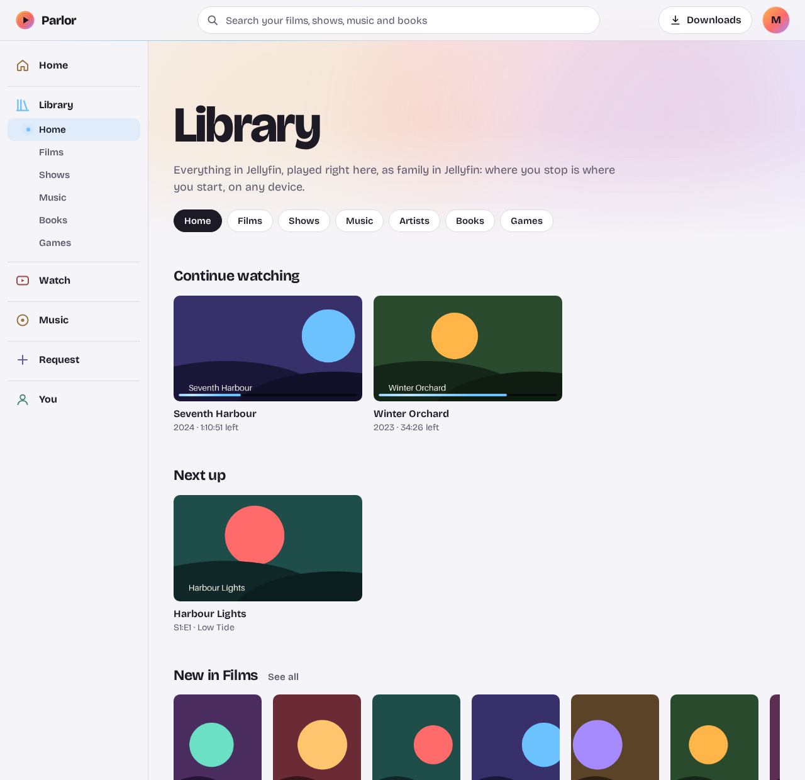

# Parlor

A room for watching, listening and playing: YouTube without ads, the films, shows, music and books in your Jellyfin, requests for more, and games, in one self-hosted app with accounts. One `docker compose` file runs Parlor and the whole stack around it, and **Parlor sets every app up itself**: you don't sign in to each one, copy API keys or add indexers.

_Formerly yeerr._

<picture>
  <source media="(prefers-color-scheme: dark)" srcset="docs/assets/screens/library-desktop-dark.png">
  
</picture>

## Install

```sh
cp .env.example .env        # set DATA (your media folder), PUID/PGID and TZ
docker compose up -d --build
```

1. Open `http://<server>:8800` and create your account. The first one is the admin.
2. Upload your VPN's WireGuard file in **Settings → Services → VPN**. Until there is one, nothing gets out: qBittorrent can't reach the internet.
3. Parlor sets up the other apps in the background. **Settings → Services** shows each app and each step.

It needs Docker Compose 2.24.3 or newer (`docker compose version` says which you have).
More: [Install, folders and moving in](docs/install.md).

## Contents

- [What's in it](#whats-in-it)
- [The apps around it](#the-apps-around-it)
- [How it works](#how-it-works)
- [On your devices](#on-your-devices)
- [Accounts](#accounts)
- [Settings](#settings)
- [Updating](#updating)
- [Security](#security)
- [All the docs](#all-the-docs)
- [Development](#development)

## What's in it

| In the menu | What it does | More |
|---|---|---|
| **Library** | Plays what's in Jellyfin, right here: films and shows with resume and Next up, music in a player that keeps going, audiobooks, and books in a reader. | [The Library](docs/library.md) |
| **Watch** | YouTube without ads, in up to 4K: search, channels, your subscriptions feed, recommendations, SponsorBlock, and fast downloads. | [Watching YouTube](docs/youtube.md) |
| **Live** | YouTube lives and the Twitch channels you follow, in Parlor's player. | [Live](docs/youtube.md#live) |
| **Movies & TV** | Discover, search and request films and shows through [Seerr](https://github.com/seerr-team/seerr), one title or a whole collection. | [Movies & TV](docs/movies-tv.md) |
| **Music** | All of [music-fndr](https://github.com/ChaseSunstrom/music-fndr): browse Spotify and download songs, albums and playlists. Request albums through Lidarr. | [Music](docs/music.md) |
| **Games** | Your Steam library, retro games played in the browser, your gaming PC streamed to any screen, and games you ask for. | [Games](docs/games.md) |

## The apps around it

The compose file runs these beside Parlor. Setup connects them once you have an account; it only ever adds what's missing.

| App | Its job | What Parlor's setup gives it |
|---|---|---|
| Jellyfin | Holds and plays your library | Your name and password as its admin, and a library per kind of media |
| Seerr | Takes requests for films and shows | That Jellyfin account, its libraries, Radarr and Sonarr |
| Sonarr, Radarr, Lidarr | Find and fetch shows, films and music | Their folders, qBittorrent, and a **Best available** quality profile |
| Prowlarr, FlareSolverr | Search the indexers | Public indexers that answer, kept fresh twice a day |
| qBittorrent, Gluetun | Download, only through your VPN | No way out until you upload a WireGuard file |
| Bazarr | Subtitles | Sonarr and Radarr |
| Cleanuparr | Clears stuck, failed and junk downloads | The *arrs and qBittorrent, with its cleaners on |
| Questarr | Games you ask for | Your login, qBittorrent, Prowlarr's indexers. No IGDB keys needed |
| Checkrr | Finds files that no longer play | Your library folders; the *arr that owns a broken file fetches it again |

More: [The apps around Parlor](docs/stack.md) (what setup does, torrents, the VPN, broken files).

## How it works

Parlor is the one app you open. It keeps the sign-in and the accounts, and talks to the other apps for you, so each does one job:

<picture>
  <source media="(prefers-color-scheme: dark)" srcset="docs/assets/diagrams/architecture-dark.svg">
  
</picture>

More: [the path of a request, and what it costs to run](docs/how-it-works.md).

## On your devices

| Where | How | More |
|---|---|---|
| Phone, tablet, computer | Parlor installs as an app from the browser (over https), and saves music, videos and films for offline. | [Phones, tablets and computers](docs/devices.md) |
| Android | `scripts/build-android.sh` builds an app that works over plain http too. | [The Android app](docs/devices.md#the-android-app) |
| Linux, Raspberry Pi, Windows, macOS | The desktop app plays films in mpv from the original file, and retro games in RetroArch, when the computer has them. The Windows and macOS builds haven't been run yet. | [The desktop app](docs/devices.md#the-desktop-app) |
| TV | Open `http://your-server:8800/tv` and pair it with a code. Your phone is the remote. | [On a TV](docs/tv.md) |
| Music apps | Symfonium, Tempo, DSub, Feishin and others, over the Subsonic API. | [Music apps](docs/music.md#music-apps-subsonic) |
| Scripts and other programs | An API key and `/api/v1`. | [The API](docs/api.md) |

## Accounts

- The first account is the admin, created on first visit.
- More people: **Settings → People → Add someone**, sign-in with Jellyfin, or open sign-up (off by default).
- Each account has its own subscriptions, history, resume points and watch later. Downloads and the music library are shared.
- An admin sets, for each member, which sections and which Jellyfin libraries they can use.
- Anyone can make a video they downloaded private: encrypted, and shared only by name.

More: [Accounts and who can use what](docs/accounts.md).

## Settings

Set these in `.env` (see `.env.example`). The ones most installs touch:

| Variable | Default | What it does |
|---|---|---|
| `DATA` | `/data` | Your media folder. Every app sees it as `/data`. |
| `PUID`, `PGID` | `1000` | The user and group that own `DATA` (`id` shows yours). |
| `TZ` | `Etc/UTC` | Your time zone. |
| `MOVIES`, `SHOWS`, `MUSIC`, `BOOKS`, `GAMES`, `YOUTUBE`, `DOWNLOADS` | `DATA/<kind>` | Where that kind lives, for another disk or a library you already have. |
| `LAN_SUBNET` | `192.168.0.0/16` | Your home network. |
| `PORT` | `8800` | Parlor's port. |

More: [the rest of the settings](docs/settings.md).

## Updating

```sh
docker compose pull && docker compose build --pull && docker compose up -d
```

yt-dlp needs no updating by hand: Parlor updates it on every start, every `UPDATE_HOURS`, and straight away when YouTube changes something. More: [Keeping up with YouTube](docs/youtube.md#keeping-up-with-youtube).

## Security

- Every API call needs a session, passwords are hashed with scrypt, and wrong passwords are throttled.
- Everything Parlor itself writes is encrypted at rest. **Back up the key**: Settings → Security → **Download the key**. Lose it and the data is lost.
- Put Parlor behind HTTPS (a reverse proxy) if it's reachable from outside your home.
- The other apps skip their logins on your home network. Keep untrusted devices on a guest network, and don't forward the apps' ports to the internet.

More: [Security](docs/security.md).

## All the docs

| Page | What's in it |
|---|---|
| [Install, folders and moving in](docs/install.md) | Starting it, a folder per kind of media, moving over from your own compose, upgrading from yeerr, updating |
| [The apps around Parlor](docs/stack.md) | What setup does, Settings → Services, torrents, the VPN, broken files (Checkrr) |
| [How it works](docs/how-it-works.md) | The parts, the path of a request, what it costs to run |
| [Accounts and who can use what](docs/accounts.md) | Sign-in, Seerr users, access per member, private items |
| [The Library](docs/library.md) | Films, shows, music, audiobooks and books from Jellyfin |
| [Watching YouTube](docs/youtube.md) | The player, browsing, subscriptions, recommendations, Live and Twitch, downloads |
| [Movies & TV](docs/movies-tv.md) | Requests through Seerr, and whole collections |
| [Music](docs/music.md) | music-fndr, requesting music, music apps over Subsonic |
| [Games](docs/games.md) | Steam, retro games, streaming from your PC, Questarr |
| [Phones, tablets and computers](docs/devices.md) | Installing, the queue, saving for offline, the Android app, the desktop app |
| [On a TV](docs/tv.md) | Pairing, the remote, the TV set's own power, input and volume |
| [The API](docs/api.md) | API keys and `/api/v1` |
| [Settings](docs/settings.md) | The variables you can set in `.env` |
| [Security](docs/security.md) | Sessions, the apps' logins, encryption at rest |
| [Development](docs/development.md) | Running it from source, the tests, where things are |

## Development

```sh
cd app && ../.venv/bin/python -m unittest discover -s ../tests   # unit tests, no network
```

More: [Development](docs/development.md). [DESIGN.md](DESIGN.md) describes the look.
