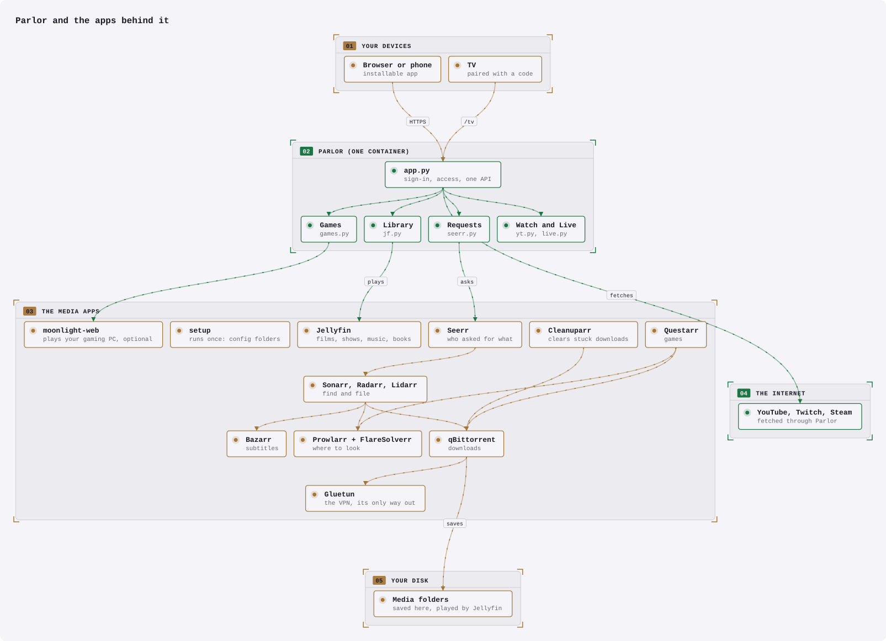
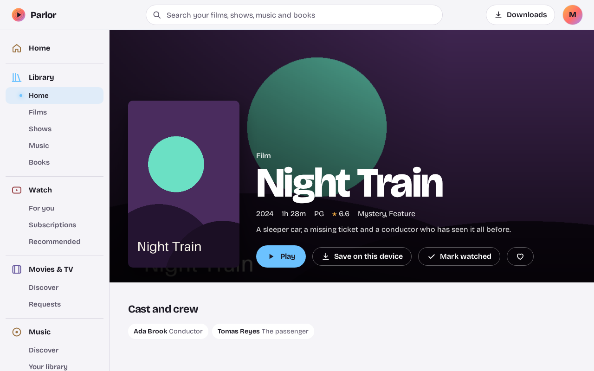
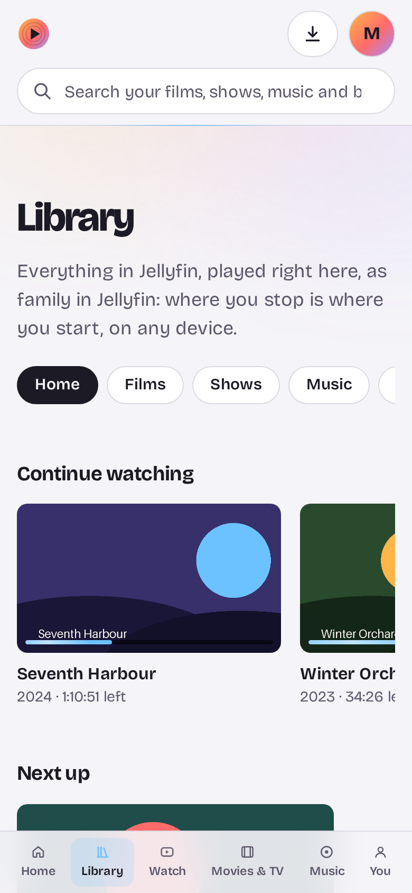
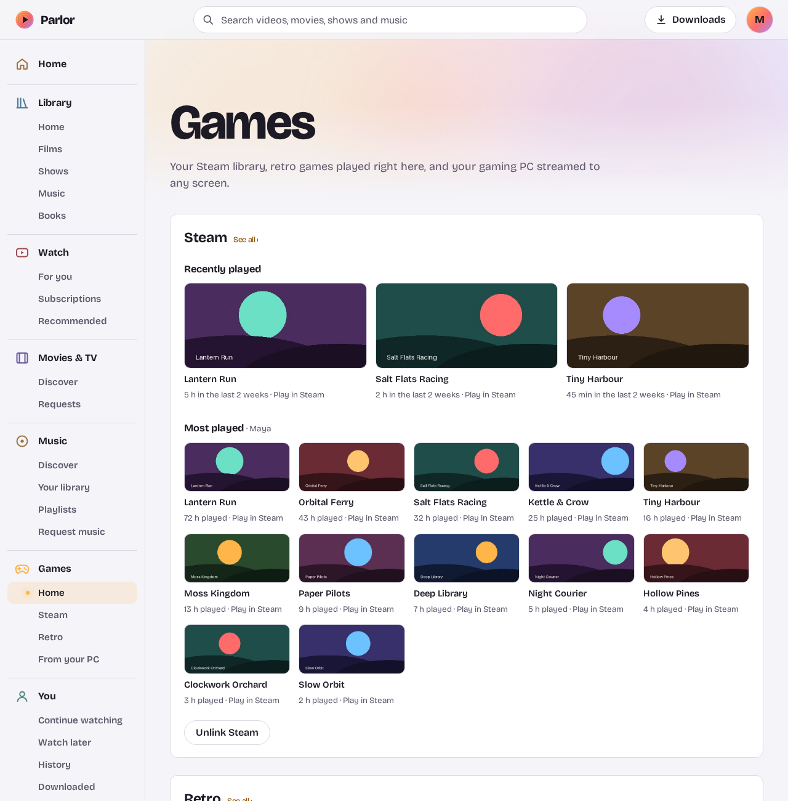

# Parlor

_Formerly yeerr._ A room for watching, listening and playing: YouTube, films and shows, music, books and the apps that fetch them, in one place.

YouTube, movies and TV, and your music library, in one self-hosted app with accounts.

<picture>
  <source media="(prefers-color-scheme: dark)" srcset="docs/assets/screens/library-desktop-dark.png">
  
</picture>

- **Library**: play what's in Jellyfin right here: films and shows with resume, next up and watched marks kept in your Jellyfin account, music in a player that keeps going while you look around, audiobooks, and books in a reader.
- **Watch**: YouTube without ads, in up to 4K. Search, channels, playlists, your subscriptions feed, recommendations, continue watching, watch later and history. Fast downloads with chapters, subtitles and the thumbnail built in, or just the audio, straight into your music library.
- **Movies & TV**: discover, search and request films and shows through [Seerr](https://github.com/seerr-team/seerr). Each person requests as their own Seerr user. Trailers play in the ad-free player.
- **Music**: all of [music-fndr](https://github.com/ChaseSunstrom/music-fndr). Browse Spotify and download songs, albums, playlists and whole discographies into your music folder, with synced playlists and library tidying.

One `docker compose` file runs Parlor and the whole stack around it: Sonarr, Radarr, Lidarr, Prowlarr, FlareSolverr, qBittorrent behind a Gluetun VPN, Bazarr, Jellyfin, Seerr and Cleanuparr. **Parlor sets them all up itself**: you don't sign in to each app, copy API keys or add indexers.

## Run it

```sh
cp .env.example .env        # set DATA (your media folder), PUID/PGID and TZ
docker compose up -d --build
```

It needs Docker Compose 2.24.3 or newer (`docker compose version` says which you have).

Open `http://<server>:8800`, create your account, and upload your VPN's WireGuard file in **Settings → Services → VPN** ([more](#the-vpn)). Parlor then, in the background:

- reads every app's API key from its config folder;
- turns off logins **on your home network** in Sonarr, Radarr, Lidarr, Prowlarr, qBittorrent and Cleanuparr (from outside, the others take your Parlor name and password; qBittorrent keeps its own, which it prints in its log the first time);
- gives Sonarr, Radarr and Lidarr their folders (`/data/shows`, `/data/movies`, `/data/music`) and qBittorrent as their download client, each with its own category, saving to `/data/downloads`;
- connects Prowlarr to all three, adds FlareSolverr for sites behind Cloudflare, and adds public indexers, keeping only the ones that answer (tried again on every run); then **keeps the list fresh by itself**: twice a day it tries more of the public torrent sites Prowlarr knows (Prowlarr updates its own list of them), adds ones that work, up to 15, switches off ones that have failed for three days and turns them back on once they answer. One you delete or switch off yourself stays that way, and a Prowlarr that only has indexers of your own is left alone;
- finishes Jellyfin's first-run setup with **your name and password** as its admin and adds libraries for movies, shows, music, YouTube downloads and books;
- sets up Seerr through that Jellyfin account, with its libraries, Radarr and Sonarr;
- connects Bazarr (subtitles) to Sonarr and Radarr, and Cleanuparr to the *arrs and qBittorrent;
- gives Sonarr, Radarr and Lidarr a **Best available** quality profile (every quality except disc images, raw captures, cinema recordings and WAV; upgrades on, up to 4K remux or lossless), which Seerr's requests and Parlor's music requests use, and has each app search for **better copies once a week** (their RSS sync grabs new ones as they appear). Settings → Services → Download quality switches back to each app's own profile; a profile you pick yourself in Seerr or Lidarr afterwards is left alone. Best available can mean 4K files of 40 GB or more;
- turns on Cleanuparr's cleaners: downloads that fail to import, stall, crawl (an hour under 20 KB/s) or never get their metadata are removed, blocklisted and **searched for again**; junk and malware files in torrents are blocked (Cleanuparr's own list), and a torrent goes only if all of it is junk; finished torrents are cleared after seeding to ratio 2 or for two weeks (your library keeps its copy). Each is set up once: change or delete it in Cleanuparr and it stays that way.

**Torrents** (admins; the link is in the Downloads drawer and next to qBittorrent in Services) shows qBittorrent's torrents live: progress, speeds, time left, ratio. You can pause and resume them (one or all), check the files again, ask the trackers for more peers, change the category, and remove a torrent with or without its files. It also sets download and upload limits, turns on slow mode (qBittorrent's alternative limits) and adds a magnet link. **Open qBittorrent** opens qBittorrent's own page at `/qbit/` for everything else, signed in through Parlor: only admins get in, and there's no second login. Outside Parlor's compose, set `QBITTORRENT_URL`, `QBITTORRENT_USER` and `QBITTORRENT_PASSWORD`; Parlor keeps qBittorrent's session to itself (and after a wrong password waits a minute before trying again, so qBittorrent doesn't ban it). qBittorrent's page runs on Parlor's address, so a flaw in qBittorrent's own page could act as the admin in Parlor; keep qBittorrent up to date. Its port (8080) is also open on your home network, where qBittorrent skips its login.

**What the apps are doing, in Parlor.** The Downloads drawer lists what Sonarr, Radarr and Lidarr are fetching beside your videos and songs: progress, time left, and why one is stuck (a download that won't import says so in red). **Movies & TV** opens with *Downloading now* and *Coming up*, the episodes and films due in the next two weeks; each opens its page in Parlor. **Music → Request music** sends albums and artists to Lidarr, since Seerr has no Lidarr support: search, then ask for one album (only it is wanted and searched for, not the artist's whole catalogue) or a whole artist; asking again searches again. Anyone signed in can request, as with Seerr. **A request never just sits there:** Parlor follows each album through searching, downloading and importing. When Lidarr finds nothing in 6 hours, two of its downloads fail, or its download (or its import) doesn't move for 12 hours, Parlor looks for the album on Spotify; with one sure match it stops Lidarr looking (the album is unwatched and its downloads removed and blocklisted), gets the album from YouTube with music-fndr into `/data/downloads/parlor-music`, tags it with the album's MusicBrainz ids and has Lidarr import it, telling Lidarr which track each file is (its own matching turns down most YouTube copies). Lidarr then counts it as there, watches it again and can still upgrade it later. If more than one Spotify album could be it, or none, you pick, and Lidarr keeps looking meanwhile. **Your requests** on the same page shows each one's state and why, with **Retry** and **Get it from YouTube** (don't wait for Lidarr). Lidarr's own wanted list (albums added in Lidarr, or by watching an artist) is followed too and shown to admins; it goes to YouTube only if an admin turns that on (Settings → Music requests), a few albums at a time. Readarr, for books, is retired upstream, so the stack has none; the Books library in Jellyfin reads whatever you put in `/data/books`.

**Settings → Services** shows each app, whether it answers, and what setup did, step by step. **Set up again** re-checks everything and puts back anything that went missing. It only ever adds what's missing and never touches a login you set yourself. On later restarts Parlor re-checks what it can without your password.

Your media folder ends up like this (every container sees the same `/data/<kind>` paths):

```
DATA/
  downloads/   qBittorrent, a folder per category
  movies/  shows/  music/  youtube/  books/  games/
```

`games/` holds retro games for Games → Retro, in `games/roms/<system>/` (see [Games](#games)).

### Folders per kind

Each kind can live somewhere else, such as another disk or a library you already have. Set any of `MOVIES`, `SHOWS`, `MUSIC`, `BOOKS`, `GAMES`, `YOUTUBE` and `DOWNLOADS` in `.env`; each defaults to `DATA/<kind>`. Inside every container that uses it, the folder still appears at `/data/<kind>`, so the apps' settings (root folders, Jellyfin libraries, qBittorrent's save path) don't change.

```
DATA=/srv/media            # everything not listed below
MOVIES=/mnt/bigdisk/films  # an existing library: Radarr, Jellyfin and Bazarr find it at /data/movies
```

To use a library you already have, point its kind at it (`MOVIES=/path/to/your/movies`) and run `docker compose up -d`; the apps' root folders and Jellyfin's libraries already point at `/data/<kind>`, so they find what's there (Settings → Services → Set up again re-checks them). The folder must be readable and writable by `PUID:PGID`.

**Moves between different disks are copies, not instant.** Left unset, every kind is a folder inside `DATA`, all in one mount, so a finished download reaching your library (`downloads` to `movies`, `shows` or `music`) is an instant move or a hardlink that takes no extra space while it seeds. A kind set in `.env` is mounted on its own, and Linux treats two mounts as different places even on one disk: moving into or out of it copies the file, and while the torrent seeds it takes twice the space. So set a kind only for a folder outside `DATA`, such as another disk or an existing library; a folder already inside `DATA` is simply `/data/<that folder>`.

Two things to do before you set one:

- **Mount the disk first.** If the path isn't there when the stack starts, Docker makes an empty folder at it on your system disk, and downloads fill that disk instead.
- **Move what's already in `DATA/<kind>` there.** Once a kind is set, the apps see only its new folder; what's left in `DATA/<kind>` is hidden from them, and Radarr or Sonarr would think it's missing and search for it again.

### Moving over from your own compose

The compose keeps each app's config in `./<app>/config`, the usual hand-made layout. Stop your old stack (`docker compose down` in its folder), copy those `config` folders next to this compose (and your `wg0.conf` to `gluetun/wireguard/`, or upload it later), set `DATA` to the folder you mounted as `/data` before, and start this one. Everything you set up stays; Parlor adds only what's missing: an app that already has a root folder, indexers or a login keeps them, and an indexer you delete stays deleted.

### Upgrading from yeerr

Parlor was formerly yeerr. Running it from this folder already? Stop it under its old project name, then start Parlor:

```sh
docker compose -p yeerr down   # formerly yeerr: the old containers would hold the ports
docker compose up -d --build
```

Setup moves `./yeerr/config` to `./parlor/config` before Parlor starts (formerly yeerr), so accounts and settings come along; sign-ins, open pages and saved preferences from before keep working. A reverse proxy that pointed at the service name `yeerr` should point at `parlor` now (formerly yeerr).

From the very first version (formerly yeerr, the one with the `yeerr-data` volume), copy its accounts and Seerr's settings out of the Docker volumes once, before the first start (`docker volume ls` shows the exact names):

```sh
docker compose -p Parlor down
mkdir -p parlor/config seerr/config
docker run --rm -v yeerr_yeerr-data:/from -v "$PWD/parlor/config:/to" alpine sh -c 'cp -a /from/. /to/ && chown -R 1000:1000 /to'   # formerly yeerr
docker run --rm -v yeerr_seerr-config:/from -v "$PWD/seerr/config:/to" alpine sh -c 'cp -a /from/. /to/ && chown -R 1000:1000 /to'   # formerly yeerr
```

Then move your music to `$DATA/music` and downloaded videos to `$DATA/youtube` (use your `PUID:PGID` if they aren't 1000).

### The VPN

qBittorrent reaches the internet only through Gluetun, and Gluetun needs your VPN provider's WireGuard file. Upload it any time, with everything running: **Settings → Services → VPN → Upload a WireGuard file**. Until there is one, **nothing gets out**: qBittorrent can talk to your home network and the other apps, not the internet, so nothing downloads in the open while you set up. Uploading another file switches servers (Gluetun restarts on it); removing it blocks again. If the tunnel drops, Gluetun's kill switch keeps qBittorrent offline until it's back.

Parlor checks the file before saving it (a `[Interface]` with `PrivateKey` and `Address`, one `[Peer]` with `PublicKey` and `Endpoint`) and looks up a host name in `Endpoint`, since Gluetun needs an address. The file is readable by root only and never shown again.

Don't want a VPN? **Run without a VPN…** in the same place asks you to confirm, then lets qBittorrent connect directly (your home's address is then visible to everyone you download from). **Turn the VPN back on** blocks again. Without Parlor's page: `touch gluetun/Parlor-vpn-off` does the same, and deleting it undoes it. (A first version of this compose read `WIREGUARD_CONF` from `.env`; that setting is gone: upload the file, or put it at `gluetun/wireguard/wg0.conf`.)

Coming from music-fndr? Stop its container first: Parlor uses the same port (8800). Point `DATA` at the folder that holds your music as `music/`; Parlor picks up music-fndr's queue and synced playlists from `music/.music-findr/`.

## How it works

Parlor is the one app you open. It keeps the sign-in and the accounts, and talks to the other apps for you, so each does one job:

<picture>
  <source media="(prefers-color-scheme: dark)" srcset="docs/assets/diagrams/architecture-dark.svg">
  
</picture>

Asking for a film shows the whole path. You never leave Parlor, and the film turns up in your Library when it has downloaded:

<picture>
  <source media="(prefers-color-scheme: dark)" srcset="docs/assets/diagrams/request-dark.svg">
  
</picture>

What it costs to run, measured on one machine against the apps beside it:

<picture>
  <source media="(prefers-color-scheme: dark)" srcset="docs/assets/charts/cost-dark.svg">
  
</picture>

## Accounts

The first account is the admin, created on first visit (nobody can sign in, not even with Jellyfin, until it exists). After that, accounts come from:

- **Settings → People → Add someone** (name and password), or
- **Jellyfin**: set the Jellyfin address in Settings (or `JELLYFIN_URL`). Anyone can then sign in with their Jellyfin name and password, and gets an account here the first time. Jellyfin admins are admins here. A Jellyfin account never takes over a local account with the same name.
- **Open sign-up**: a switch in Settings; off by default.

Each account has its own subscriptions, history, resume points, watch later and YouTube cookies. Downloads and the music library are shared.

**Seerr users.** Requests go to Seerr as the person's own Seerr user, so Seerr's quotas, permissions and approvals apply. People who sign in with Jellyfin are linked to the Seerr user with the same Jellyfin account by themselves. Everyone else is linked by an admin in Settings → People, which points out a Seerr user with the same name (names alone aren't trusted: with open sign-up anyone could pick one). Members who aren't linked can browse but can't request; an admin who isn't linked requests as the API key's owner.

### Who can use what

Settings → People → **Access** sets, for each member, what they can use:

- **Watch** (YouTube), **Movies & TV** (discovering and requesting), **Music** (finding and requesting music, and music apps over Subsonic), **Library** (playing what's in Jellyfin), **Games** and **Downloads** (saving videos and songs to the server). A section that's off leaves their menus, and the server refuses it too, from the page, the API or a music app.
- **Which Jellyfin libraries they see.** Jellyfin holds this itself: a member limited to some libraries plays as a Jellyfin user of their own (their Jellyfin sign-in, or one Parlor makes for them, hidden and with a password nobody needs), whose library list Parlor keeps in step. Search, Next up, pictures and streams follow it, in Parlor and in Jellyfin's own apps. Someone sharing the default Jellyfin user is given their own first, so the others keep theirs. If Jellyfin can't be reached while you save, they see no library until it can, never every library.

**Private items.** Anyone can make a video they downloaded private (the lock button on Downloaded): it leaves the shared video folder and is encrypted with a key of its own, which is sealed to the people it's for. Each person turns this on once in Settings → Private items, which makes them a key pair: the private half is sealed by their password, and by a **recovery code shown once**. Parlor opens it only in memory, for a signed-in session, so after a restart the page asks for the password again. The owner shares it by name with people who have it turned on, and taking someone off re-encrypts the file with a new key, so a key they kept opens nothing. Nobody else sees it, its title included, and an admin can't open it without being given it. Changing your password in Parlor keeps it; an admin resetting your password (or a Jellyfin account's password changing in Jellyfin) can't open it, and your recovery code then seals it to the new password (without the code it's lost). Private videos play in Parlor, with seeking, and stay out of Jellyfin's and the music apps' reach; the thumbnail and subtitle files are left behind (deleted), and deleting an account deletes its private files. **Back to the shared library** decrypts one into the video folder again. A deleted file can linger on an SSD until it's overwritten, so for the strongest protection encrypt the disk as well (see [Encrypted at rest](#encrypted-at-rest)).

Admins always have everything, and accounts from before this have everything until you change it. The apps' own pages (Sonarr, qBittorrent and the rest) are admin tools outside these settings; keep their ports to your home network.

## The Library: playing Jellyfin in Parlor

<picture>
  <source media="(prefers-color-scheme: dark)" srcset="docs/assets/screens/film-desktop-dark.png">
  
</picture>

Library plays what Jellyfin has, inside Parlor, with Parlor's login. Each person plays as their Jellyfin user (their Jellyfin sign-in, the user an admin linked, or the default in Settings), so resume points, watched marks, favourites and Next up are the same here as in Jellyfin's own apps.

- **Films and shows**: Continue watching, Next up and what's new in each library; every film, show, album and book with sorting (A–Z, recently added, year, rating, shuffle) and filters (new to you, in progress, favourites); a show's seasons and episodes. **Play** resumes where you stopped; **From the start** doesn't. Your place is saved every few seconds and when you pause; near the end it's marked watched and the next episode starts after a countdown.
- **Playback**: Jellyfin sends the file as it is when the browser can play it (H.264 or HEVC in MP4, VP9 or AV1 in WebM) and converts it otherwise; the quality menu asks for a lower bitrate when you're away from home. Audio tracks, subtitles and chapters have menus. Keys: Space or K, J and L or ← and → for 10 s, F for full screen, M to mute, Shift+N for the next episode.
- **Music and audiobooks** play in the bar along the bottom, which keeps playing as you move around Parlor and answers the lock screen's and keyboard's media keys. Albums play in order or shuffled; an audiobook carries on from where you stopped, on any device. Songs in your own music folder (Music → Your library → an album) play there too.
- **Books**: EPUB books open in a reader (pages, contents, text size; it remembers your page on that device), PDFs in the browser's own viewer. Reading needs your Jellyfin user to be allowed to download.
- **Movies & TV** shows **Play** (or **Watch**, for a show) on a title Jellyfin has, straight into the Library.
- **The Jellyfin key stays on the server.** Streams, pictures and books go through Parlor, which adds the key itself and checks each one against what your Jellyfin user may see.

## Watching YouTube

The player streams through your server. YouTube serves HD video and audio separately, and its stream links only work from the address that asked for them. Parlor fetches both, in byte ranges, and the player keeps them in step. Seeking, quality changes (144p to 4K, HDR when your browser can show it), captions, playback speed, picture-in-picture and your system's media keys all work.

- **SponsorBlock**: sponsors, self-promotion and "like and subscribe" segments are skipped (with Undo), and the seek bar shows every marked segment, the chapters and YouTube's "most replayed" curve. Choose categories in Settings. Lookups use a hash prefix, so SponsorBlock never learns which video you're watching.
- **Resume**: videos pick up where you left off, on any device.
- **Keys**: Space or K to play and pause, J and L to skip 10 s, ← and → for 5 s, ↑ and ↓ for volume, M to mute, F for full screen, T for theater mode, C for captions, < and > for speed, 0–9 to jump, Shift+N for the next video, / to search.
- Live streams open on YouTube.

### Browsing

You don't need links or an account to find something to watch. **Watch → Home** has:

- **Continue watching**, and **Because you watched …**: the videos YouTube suggests beside the ones you watched last.
- **New from your subscriptions**.
- **Topics**: a shelf of this week's most-watched videos for each topic you pick (Music, Gaming, Science… to start; **Edit topics** to change them). YouTube retired its Trending page, so this stands in for it. Each account has its own topics.

The player's **Up next** list is YouTube's own suggestions for that video, and autoplay follows it. Channels in search results have a Subscribe button.

### Subscriptions

Subscribe on any channel or video page, or import them in Watch → Channels from:

- Google Takeout (`subscriptions.csv`, under YouTube and YouTube Music)
- NewPipe or FreeTube (`.json`)
- Invidious or FreeTube (`.opml`)
- a list of channel links or `@handles`

The feed reads each channel's public RSS feed (no Google account involved) and falls back to yt-dlp when a feed is down. **Hide Shorts** filters them out. Export your list as OPML any time.

### Recommended

Without a YouTube account, Recommended mixes videos like the ones you watched last with new videos from the channels you watch most but don't follow, so no single video or channel takes over.

For YouTube's own recommendations, add your YouTube cookies in Settings. Export them with a "cookies.txt" browser extension while signed in to youtube.com. This also adds your YouTube feed and YouTube watch later, and plays videos that need a sign-in (age-restricted ones). The cookies are stored with owner-only permissions and used only for those requests. YouTube can flag accounts used this way, so a spare account is safer.

### Live

Watch → **Live** shows who's live now: YouTube lives from your subscriptions (with what's starting soon) and the Twitch channels you follow.

- **YouTube lives** play in Parlor's player like any video, without ads. Go back over the last hour or so; the **LIVE** badge turns into **Go live** when you're behind, and takes you back. **Low latency** brings you closer to live, at the price of more pauses on a weak connection.
- **Twitch** needs no account. Follow channels by name or link, search for them, or paste many at once (Twitch's own export works). A channel's page plays it live with its chat beside it (read-only), and lists its past broadcasts and clips. Twitch's ads are taken out on the way: while one runs, the picture holds with a note, and the stream is back when it ends; the ad itself is never fetched.
- Everything goes through Parlor, so your browser never talks to YouTube or Twitch, and Parlor hands out only addresses it has signed, so it can't be used to fetch anything else.

### Downloads

Use the download button on any video (choose Best up to 4K, 1080p, 720p or 480p), or **Download all** on a playlist.

- **Videos** go to `VIDEO_DIR/<channel>/<title> [<id>].mp4`, with chapters, English subtitles, the thumbnail and the description embedded. Jellyfin and Plex read them, and they play in Parlor from Watch → Downloaded. Up to 1080p Parlor prefers H.264 + AAC, which plays everywhere; higher qualities only exist as VP9 or AV1.
- **Cut sponsors out of downloaded videos** (Settings) removes SponsorBlock's sponsor segments from the file.
- **Save audio to music** puts a tagged audio file (artist, album, square cover art) in your music library, in music-fndr's format and bitrate. Non-music parts of music videos are cut out.
- Downloads resume after a restart. If YouTube rate-limits the server, they wait 15 minutes and try again instead of failing.
- **Clearing out old downloads** (Settings → Downloaded videos, off by default): delete each video a week, 30 days, 90 days… after it was downloaded, or only once someone has watched it to the end, counting from then. Press **Keep** on a video in Watch → Downloaded and it's never deleted automatically. Each video there says when it goes.

## On phones, tablets and computers

<picture>
  <source media="(prefers-color-scheme: dark)" srcset="docs/assets/screens/library-phone-dark.png">
  
</picture>

Parlor installs as an app: on Android, Chrome's menu has **Install app**; on iPhone and iPad, Safari's **Share → Add to Home Screen**; on a computer, Chrome's and Edge's address bar has an install button (Settings → This device has one too). It opens in its own window with the system's media controls. Installing and saving for offline need Parlor's **https** address: a plain `http://` address on your home network works in the browser but can't install. Put Parlor behind a reverse proxy with a certificate (Caddy gets one on its own), or run `tailscale serve` on the server and use its `https://` address. The Android app (below) works over plain http too.

- **The queue**: every song's and album's **⋯** has **Play next** and **Add to queue**. The queue button in the player shows it: drag a song by its grip (or move it with the arrow keys), take one out, **Shuffle** (the song playing stays; turning it off puts the order back) and **Repeat** (all, or one). The next song loads while this one plays, so it starts the moment this one ends, with no pause to load (it isn't sample-exact gapless, so live albums keep a tiny seam). The queue is kept on the device, per person, and after a reload it's back, paused where it was.
- **Saved for offline**: **⋯ → Save on this device** on an album or a song (yours from Jellyfin, or from your music folder), the save button on a downloaded video (Watch → Downloaded), and **Save on this device** on a Jellyfin film or episode (one at a time, not a whole season), keep them in the browser's own storage on that device. With no network, or away from home without a way in, Parlor still opens: on **Saved for offline** (You → Saved for offline), where the music plays in the player and the videos play with seeking; a song you saved plays from the device even online, and so does a saved film or episode, in the Library's player with seeking and the text subtitles saved beside it (picture-based subtitles aren't saved, and the press says so). A place you reach in a film with no connection is kept on the device and goes to Jellyfin when Parlor reaches it again. Saving goes in pieces, so a download that breaks off carries on from where it stopped. The page shows the space used; **Remove** frees it. Anything Jellyfin would have to convert (a song, a film or an episode) can't be saved as it is, and the press says why.
- **The app itself** is kept on the device by a service worker: online, Parlor's newest page always wins, and an open window says when a new Parlor is ready. Nothing with your data (searches, lists, streams) is kept by it. `OFFLINE=off` in `.env` makes every device's copy remove itself.
- **The Android app**: `scripts/build-android.sh` builds `dist/parlor.apk` in Docker (Capacitor, every version pinned; about two minutes the first time). Later builds install over it, keeping what's saved; `--clean` starts over with a new signing key, which means uninstalling the old app first. Install it on the phone (allow installing from your file manager), open it and type Parlor's address, the one you use in a browser, like `http://192.168.1.20:8800`; then sign in as usual. The app carries Parlor's page with it and passes its requests on to your server, so everything works as in the browser, saving for offline included, over plain http on your home network. Music keeps playing with the screen off, with a media notification and lock-screen controls. **Settings → This device → Use another Parlor** switches servers. `tests/live_android.py` checks it on an Android emulator.
- **iPhone and iPad**: a Home Screen app can stop playing when it's in the background or the screen locks, and Safari may clear saved music and videos from a Home Screen app that hasn't been opened for a few weeks.

## On a TV

<picture>
  <source media="(prefers-color-scheme: dark)" srcset="docs/assets/screens/tv-screen-desktop-dark.png">
  
</picture>

<picture>
  <source media="(prefers-color-scheme: dark)" srcset="docs/assets/screens/remote-phone-dark.png">
  
</picture>

Open Parlor on the TV's browser at `http://your-server:8800/tv` (or install the Android app on an Android TV: it's in the TV's launcher and opens this way by itself). The TV shows an 8-character code; on your phone open **You → TVs**, type it and a name under **Add a TV**, press **Pair**, and the TV signs itself in to your account. No password is typed on the TV, and the code works once, for five minutes.

- **The TV layout** is made for a remote: bigger, with a bright outline on what's selected. The arrows move to the nearest thing in that direction, OK opens it, Back goes back. The menu on the left reaches every page.
- **Play on TV**: a film's or episode's **On TV** button, a YouTube video's (it carries on from where you are), and **⋯ → Play on TV** on any album or song send it to the TV, which plays it with its own sign-in. With more than one TV on, you pick which.
- **The remote** (You → TVs → a TV): a joystick (drag it for the arrows, hold to keep going, press it for OK), Back and Home, play/pause, back 10 s and forward 30 s, next song, volume, and a box that types on the TV (searching, say). It shows what the TV is playing. Two phones can drive the same TV; both see what it does. A computer's arrow keys, Enter and Space work it too.
- A TV that's off or not showing Parlor shows as off; it comes back by itself. **Unpair** signs it out. Signing out everywhere unpairs every TV. A TV is never signed in as an admin, even an admin's, so only enter a code you see on a TV in front of you. Admins see every account's TVs, and a remote for each, in **Settings → TVs**.
- The remote's volume is Parlor's on the TV; switching the TV set on, its input and its own volume aren't there yet.
- The remote talks over server-sent events, so it works through the Android app and any reverse proxy. nginx must not buffer `/api/tv/events` (Parlor sends `X-Accel-Buffering: no`, which nginx honours).

## Games

<picture>
  <source media="(prefers-color-scheme: dark)" srcset="docs/assets/screens/games-desktop-dark.png">
  
</picture>

**Games** has three parts: your Steam library, retro games played right in Parlor, and your gaming PC streamed to any screen. Each person sees their own.

- **Steam.** An admin adds a Steam Web API key once, on the Games page (get one at steamcommunity.com/dev/apikey). It stays on the server: no browser ever sees it. Each person then links their profile by its address (`steamcommunity.com/id/yourname` or `/profiles/7656…`), its custom name or its 17-digit id, and sees what they own, most played first, with what they played in the last two weeks above. Steam is asked at most once an hour per person, and its pictures come through Parlor and are kept. A private profile shows nothing; Games says which Steam privacy setting to change (Game details: Public).
- **Retro.** Put games in `GAMES/roms/<system>/` (`nes`, `snes`, `n64`, `gb`, `gbc`, `gba`, `nds`, `vb`, `genesis`, `sms`, `gamegear`, `32x`, `segacd`, `psx`, `pce`, `atari2600`, `atari7800`, `lynx`, `ngp`, `ws`, `coleco`, `arcade`, `c64`, `dos`, `psp`), with a picture of the same name beside each if you like (`Game.png`). **Play** opens the game on its own page with [EmulatorJS](https://emulatorjs.org) 4.2.3: Parlor fetches each emulator file from EmulatorJS's server the first time it's needed and keeps it only if it matches the sha256 pinned in `app/emulatorjs.json`, so after that it plays without the internet. The game's own save (its battery memory) goes to Parlor whenever it changes, and save states when you save one from the emulator's menu, both sealed like the rest of Parlor's data and each person's own; on another device they come back. Parlor only reads from inside `GAMES/roms` (links out of it are ignored). Bring your own games: only ones you own.
- **From your PC.** [Sunshine](https://app.lizardbyte.dev/Sunshine/) on your PC streams its screen; Parlor's bridge ([Moonlight Web](https://github.com/MrCreativ3001/moonlight-web-stream)) plays it in any browser, the TV's included. It's off until you turn it on in `.env`:

  ```sh
  COMPOSE_PROFILES=games-stream
  GAMES_STREAM=1
  GAMES_STREAM_HOST=192.168.1.20   # this server's address on your network
  ```

  then `docker compose up -d`. The bridge's own page is only reachable through Parlor, at Games → From your PC (an admin opens it once first): Parlor tells it who you are, so there's no second login, and each person keeps their own PCs. Add your PC by its address, and type the PIN it shows into Sunshine's page on the PC (Sunshine → PIN). The picture and sound go straight from the bridge to your browser over WebRTC on UDP ports 40000–40100, so those must reach the server; from outside your home, add a TURN server in `./moonlight-web/config/config.json` (`webrtc.ice_servers`). Gamepads and keyboard capture need Parlor on https.

## Music apps (Subsonic)

Parlor speaks the Subsonic/OpenSubsonic API, so Symfonium, Tempo, DSub, Feishin and similar apps can play your music folder.

- **Server URL:** Parlor's address (`http://your-server:8800`); the API is under `/rest`. Apps that ask for a path use `/rest`.
- **Login:** your Parlor name and password work. For apps that send a salted token instead (most do), or a long-lived key, make an **app password** in **Settings → Music apps**: it's shown once. Use it as the app's password, or as its API key. Delete it there to cut that app off.
- Stars, ratings, plays, playlists, play queue and bookmarks are per person. Playlists from music-fndr's `Playlists/` folder show up read-only.
- Tracks are found by a hash of their path in the music folder. **Moving or renaming a file makes it a new track**: its stars, ratings and play counts don't follow it (they're deleted at the next scan, every 10 minutes, once the old path is gone).
- A scan that can't open a folder, or finds no music at all (an unmounted share), removes nothing; it logs a warning instead. Files whose names aren't valid UTF-8 are skipped.

## The API

Scripts and other programs (Home Assistant, a phone shortcut, an AI agent) can use Parlor with an **API key** instead of a sign-in. Make one in **Settings → API keys**: it's shown once and stored hashed. A key acts as you, with what your account may use; a **search** key only reads, a **full** key also downloads and requests; an admin's key reaches what the admin does. A key reads what its person can and changes only what the API is for: downloads, requests and your own lists. Accounts, settings, the stack, keys, passwords, private items and the server's lock need a sign-in, an admin's key included, so a leaked key can't make itself an account or repoint the server. Deleting a key stops it at once, and **Sign out everywhere** (or an admin resetting your password) ends your keys too. Send it as `X-Api-Key` (or `Authorization: Bearer`) on any `/api` route; the full reference is at `/api/docs` once you're signed in.

The stable part is `/api/v1`:

```sh
KEY=pk_your_key_here   # made up: use yours
# one search across YouTube, films and shows (Seerr), music on Spotify and in Lidarr, and your Jellyfin library
curl -H "X-Api-Key: $KEY" "http://your-server:8800/api/v1/search?q=ok+computer"
curl -H "X-Api-Key: $KEY" "http://your-server:8800/api/v1/search?q=ok+computer&in=lidarr,spotify"
# get anything a search found: each hit's "get" list holds the bodies to send
curl -H "X-Api-Key: $KEY" -H "content-type: application/json" -d '{"kind": "lidarr_album", "id": "b1392450-e666-3926-a536-22c65f834433"}' \
  http://your-server:8800/api/v1/get        # → {"job": "request:12"}
curl -H "X-Api-Key: $KEY" http://your-server:8800/api/v1/jobs/request:12
```

`kind` is one of `youtube_video`, `youtube_audio`, `track`, `album`, `artist`, `playlist` (music-fndr, Spotify ids), `lidarr_album`, `lidarr_artist` (MusicBrainz ids), `movie` and `show` (TMDB ids; `seasons` picks seasons). Sources you can't use are left out of a search, and one that's down is named in `errors` while the rest answer.

## Settings

Set these in `.env` (see `.env.example`).

| Variable | Default | What it does |
|---|---|---|
| `DATA` | `/data` | Your media folder. Every app sees it as `/data`; music is `DATA/music`, YouTube downloads `DATA/youtube`. |
| `MOVIES`, `SHOWS`, `MUSIC`, `BOOKS`, `GAMES`, `YOUTUBE`, `DOWNLOADS` | `DATA/<kind>` | Where that kind lives (another disk, an existing library). Every app sees it as `/data/<kind>`. See [Folders per kind](#folders-per-kind). |
| `PUID`, `PGID` | `1000` | The user and group that own `DATA` (`id` shows yours). The apps run as them, and folders Parlor makes belong to them. |
| `LAN_SUBNET` | `192.168.0.0/16` | Your home network (comma-separated for more than one): qBittorrent's page is reachable through the VPN from it and skips its login there |
| `PUBLIC_INDEXERS` | `yts,eztv,thepiratebay,1337x,limetorrents,nyaasi,knaben` | Public indexers Prowlarr gets (Prowlarr's names); `none` adds none |
| `PORT` | `8800` | Parlor's port |
| `SEERR_URL`, `SEERR_API_KEY` | set by the compose | For a Seerr, Overseerr or Jellyseerr elsewhere. Settings can set them. |
| `JELLYFIN_URL` | set by the compose | Turns on sign-in with Jellyfin. music-fndr also uses it, with `JELLYFIN_API_KEY`, to make playlists in Jellyfin. |
| `SONARR_URL`, `SONARR_API_KEY` (and `RADARR_`, `LIDARR_`, `PROWLARR_`, `QBITTORRENT_URL`) | the compose's services | For apps that run somewhere else |
| `OPEN_SIGNUP` | `0` | `1` lets anyone who can reach Parlor create an account |
| `YT_PARALLEL` | `2` | Videos downloading at once |
| `VIDEO_KEEP_DAYS` | `0` | Delete downloaded videos this many days after they're downloaded; `0` keeps them. Settings can change it. |
| `UPDATE_HOURS` | `24` | How often yt-dlp is updated while running (it's also updated on every start). `0` turns both off. |
| `ENCRYPT` | `1` | Parlor's data encrypted at rest; `0` keeps a new install plain. See [Encrypted at rest](#encrypted-at-rest). |
| `KEY_DIR` | `./parlor/key` in the compose, else `DATA_DIR/key` | Where the encryption key lives. Keep it apart from the data, and back it up. |
| `HEAL` | `1` | When YouTube changes something and downloads start failing, update yt-dlp straight away instead of at the next check. `0` turns that off (so does `UPDATE_HOURS=0`). |
| `GAMES_STREAM`, `GAMES_STREAM_HOST` | off | Any value (leave it out for off) and this server's address on your network turn on Games → From your PC, with `COMPOSE_PROFILES=games-stream` (see [Games](#games)) |
| `FORWARDED_ALLOW_IPS` | `127.0.0.1` | Behind a reverse proxy: its address as Parlor sees it (comma-separated for more than one; `*` only when nothing but the proxy can reach Parlor). Parlor then takes each visitor's address from `X-Forwarded-For`, so the limits on guessing passwords and TV codes count each person, not the proxy. From any other address the header is ignored. |
| `OFFLINE` | on | `off` makes the app's copy on phones and computers remove itself (see [On phones, tablets and computers](#on-phones-tablets-and-computers)) |
| `TZ` | `Etc/UTC` | Seerr's time zone |

music-fndr's own settings (`FORMAT`, `BITRATE`, `OUTPUT`, `THREADS`, `SYNC_HOURS`, `YT_DLP_ARGS`, `JELLYFIN_API_KEY`, `JELLYFIN_USER`) work as described in [its README](https://github.com/ChaseSunstrom/music-fndr#settings).

Per-device choices (playback quality, autoplay, captions language, SponsorBlock categories, Shorts) are in Settings → Playing videos.

## Updating

YouTube changes often, and a yt-dlp a few weeks old starts failing. Parlor updates yt-dlp every time it starts, checks again every `UPDATE_HOURS`, and when there's a new one it restarts between downloads to load it. Docker brings it back and the queues carry on.

When YouTube changes something before then, there's nothing to do either. A download, video or search that fails because of it (not a rate limit, not a removed or private video) makes Parlor update yt-dlp straight away, at most once an hour, to yt-dlp's nightly build when the regular release has no fix yet; it moves back to the regular release once a newer one is out. Those downloads, videos and songs alike, show "YouTube changed something; waiting for a yt-dlp update" and wait instead of failing. yt-dlp is replaced only once the running downloads have finished, new ones hold until Parlor restarts to load it, then they all carry on (each waits at most three times before it's marked failed). `HEAL=0` turns this off. If yt-dlp can't be installed there (a read-only image), Parlor says so once in its log and stops trying until it restarts; without internet for a while, it simply tries again on the next failure an hour later.

To update everything else:

```sh
docker compose pull && docker compose build --pull && docker compose up -d
```

## Security

- Every API call needs a session. Sessions last 30 days, renew while used, and are stored hashed. Passwords are hashed with scrypt.
- Every change needs an `X-Requested-With: parlor` header (formerly yeerr, still accepted), which other websites can't send, so a page you visit can't act for you.
- Wrong passwords are throttled per name and per address. Behind a reverse proxy, set `FORWARDED_ALLOW_IPS` to the proxy's address so the address is each visitor's, not the proxy's (see [Settings](#settings)).
- Changing a password signs out your other devices; Settings also has **Sign out everywhere**.
- Put Parlor behind HTTPS (a reverse proxy) if it's reachable from outside your home. The session cookie is marked secure when the proxy says the request came over HTTPS.
- The *arrs skip their logins for any private address, qBittorrent only for `LAN_SUBNET` and the other containers. Anyone on your home network can use them, so keep untrusted devices on a guest network, and don't forward their ports to the internet; from outside, they ask for a name and password. Your password is used for setup only while it runs, and never stored.

### Encrypted at rest

Everything Parlor itself writes is encrypted at rest: its database (accounts, sessions, settings and the apps' keys, history, subscriptions) with SQLCipher, and the files it keeps beside it (YouTube cookies, the download list) with AES-GCM, all with one random 256-bit key. The data folder is Parlor's alone (folders 0700, files 0600). The stack's own Seerr key isn't copied at all: Parlor reads it from Seerr's settings when it needs it.

- **The key** is made on the first start in `./parlor/key/db.key`, apart from `./parlor/config`, so a copy or backup of the config folder alone can't be read. Outside the compose, set `KEY_DIR` to a folder of its own (otherwise it goes inside `DATA_DIR`, and Settings warns you).
- **Back up the key.** Settings → Security → **Download the key** (it asks for your password; do it at home or over HTTPS, since the key crosses the network). Lose it and the data is lost: nobody can open it, Parlor included. To restore, put the file back as `./parlor/key/db.key`.
- **Upgrading** from a Parlor without encryption converts the database once at start: an encrypted copy is written and checked (every row, and an integrity check) before it replaces the old file, and the plain copy is kept as `yeerr.db.plain-backup` until the next start, then removed.
- **Lock at boot** (Settings → Security) seals the key on disk with a passphrase of yours. After every restart Parlor stays locked, downloads and music apps included, until someone opens it in a browser and enters the passphrase (five wrong ones a minute, then it waits). There's no recovery: forget the passphrase and only a backed-up key opens the data. Turning it off puts the plain key back.
- `ENCRYPT=0` keeps a new install plain; a database that's already encrypted stays encrypted and keeps opening with its key.
- **What it protects against:** a stolen disk, a copied backup or another user on the server reading Parlor's data. It doesn't protect against someone who controls the running server: an admin who changes Parlor's code can read what it opens.
- **What isn't covered:** the apps' own configs and your media, which Jellyfin, the *arrs and qBittorrent read and write directly. Encrypt the disk they're on instead: LUKS when you set the disk up (`cryptsetup luksFormat`, then unlock it at boot, before Docker starts), or `fscrypt` on an ext4 folder (`fscrypt setup`, then `fscrypt encrypt /srv/media`). Put the compose folder on it too, and the whole stack is encrypted at rest.

## Development

```sh
uv venv -p 3.12 .venv && VIRTUAL_ENV=.venv uv pip install "spotdl~=4.5.2" "spotapi~=1.2.8" "httpx<0.28" -U "yt-dlp[default]"
mkdir -p dev/music && cd dev/music && DATA_DIR=../data VIDEO_DIR=../videos ../../.venv/bin/uvicorn --app-dir ../../app app:app --reload --port 8800
cd app && ../.venv/bin/python -m unittest discover -s ../tests   # unit tests, no network
python3 tests/smoke.py http://127.0.0.1:8800                     # live check against a running Parlor
```

- `app/app.py` puts it together. `auth.py` is accounts and settings, `yt.py` is YouTube, `seerr.py` is Seerr, and `core.py` is the database and sessions.
- `app/music.py` is music-fndr's backend, copied by `scripts/vendor-music.sh ../music-fndr`. Change it in music-fndr, then copy it again.
- `app/static/` is the whole UI, with no build step. `js/music.js` is music-fndr's page code.
- [DESIGN.md](DESIGN.md) describes the look.
- `constraints.txt` pins every Python package in the image except yt-dlp (which updates itself on purpose), so a rebuild gives the same ones. To move them on: drop `-c /tmp/constraints.txt` from the Dockerfile, `docker compose build --no-cache parlor`, run the checks, then `docker run --rm --entrypoint pip parlor:latest freeze | grep -v -i -e '^yt-dlp' -e '@ file'` into `constraints.txt` (keeping its header) and put the `-c` back.
