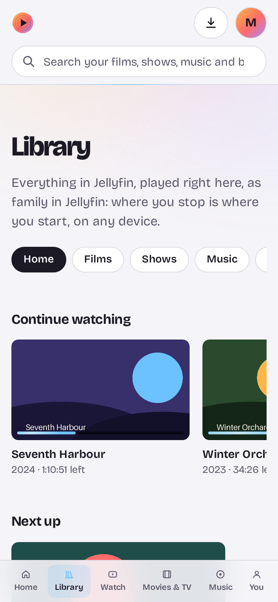
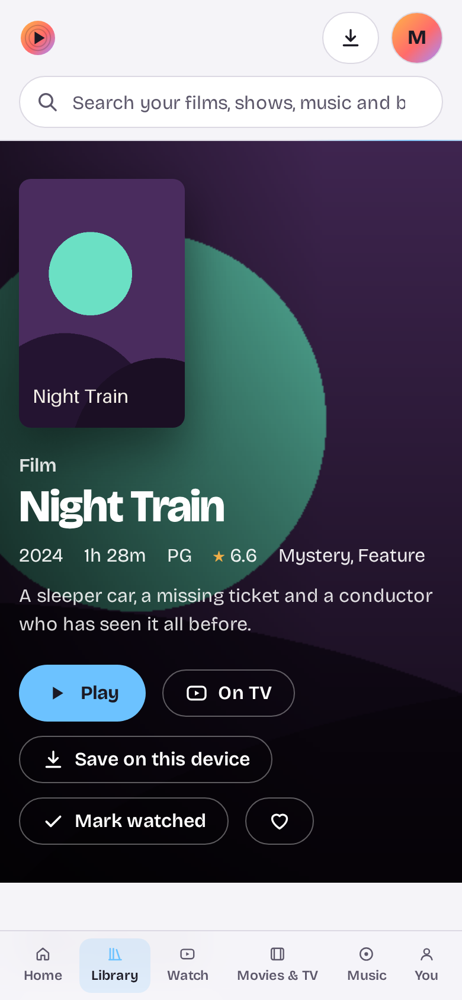

# On phones, tablets and computers

[← Parlor's README](../README.md)

<picture>
  <source media="(prefers-color-scheme: dark)" srcset="assets/screens/library-phone-dark.png">
  
</picture>
<picture>
  <source media="(prefers-color-scheme: dark)" srcset="assets/screens/film-phone-dark.png">
  
</picture>

Phones and tablets use Parlor as an installed app or the Android app. Computers can use the desktop app, which plays what a browser can't.

## Installing as an app

Parlor installs as an app. It opens in its own window with the system's media controls.

- **Android**: Chrome's menu has **Install app**.
- **iPhone and iPad**: Safari's **Share → Add to Home Screen**.
- **A computer**: Chrome's and Edge's address bar has an install button (Settings → This device has one too).

Installing and saving for offline need Parlor's **https** address. A plain `http://` address on your home network works in the browser but can't install. To get an https address:

- Put Parlor behind a reverse proxy with a certificate (Caddy gets one on its own).
- Or run `tailscale serve` on the server and use its `https://` address.

The Android app (below) works over plain http too.

## The queue

Every song's and album's **⋯** has **Play next** and **Add to queue**. The queue button in the player shows it.

- **Reorder**: drag a song by its grip, or move it with the arrow keys.
- **Remove**: take a song out.
- **Shuffle**: the song playing stays; turning it off puts the order back.
- **Repeat**: all, or one.
- **No pause between songs**: the next song loads while this one plays, so it starts the moment this one ends. It isn't sample-exact gapless, so live albums keep a tiny seam.
- **Kept on the device**: the queue is kept per person, and after a reload it's back, paused where it was.

## Saving for offline

These keep a copy in the browser's own storage on that device:

- **Music**: **⋯ → Save on this device** on an album or a song (yours from Jellyfin, or from your music folder).
- **Downloaded video**: the save button on a downloaded video (You → Downloaded).
- **Jellyfin film or episode**: **Save on this device**, one at a time, not a whole season.

With no network, or away from home without a way in, Parlor still opens: on **Saved for offline** (You → Saved for offline).

- **Music** plays in the player.
- **Videos** play with seeking.
- **Online too**: a song you saved plays from the device even online, and so does a saved film or episode.
- **In the Library's player**: a saved film or episode plays with seeking and the text subtitles saved beside it. Picture-based subtitles aren't saved, and the press says so.
- **Your place**: a place you reach in a film with no connection is kept on the device and goes to Jellyfin when Parlor reaches it again.
- **Interrupted downloads**: saving goes in pieces, so a download that breaks off carries on from where it stopped.
- **Space**: the page shows the space used; **Remove** frees it.
- **Conversions**: anything Jellyfin would have to convert (a song, a film or an episode) can't be saved as it is, and the press says why.

## The app itself

The app is kept on the device by a service worker.

- Online, Parlor's newest page always wins, and an open window says when a new Parlor is ready.
- Nothing with your data (searches, lists, streams) is kept by it.
- `OFFLINE=off` in `.env` makes every device's copy remove itself.

## The Android app

`scripts/build-android.sh` builds `dist/parlor.apk` in Docker (Capacitor, every version pinned; about two minutes the first time).

- **Later builds**: they install over it, keeping what's saved.
- **Start over**: `--clean` starts over with a new signing key, which means uninstalling the old app first.
- **Install**: put it on the phone (allow installing from your file manager).
- **Open it**: type Parlor's address, the one you use in a browser, like `http://192.168.1.20:8800`; then sign in as usual.
- **How it works**: the app carries Parlor's page with it and passes its requests on to your server, so everything works as in the browser, saving for offline included, over plain http on your home network.
- **Music**: it keeps playing with the screen off, with a media notification and lock-screen controls.
- **Switch servers**: **Settings → This device → Use another Parlor**.
- **On a TV**: signed in with a password, it becomes your account's TV, so your phone works it as a remote and other accounts add themselves from **You → Add a remote** (see [Adding someone's phone as a remote](tv.md#adding-someones-phone-as-a-remote)).
- **Test**: `tests/live_android.py` checks it on an Android emulator.

## iPhone and iPad

- A Home Screen app can stop playing when it's in the background or the screen locks.
- Safari may clear saved music and videos from a Home Screen app that hasn't been opened for a few weeks.

## The desktop app

For a computer that plays what the browser can't: a 4K HDR film, DTS or TrueHD sound, an odd container. The desktop app is the same Parlor in a window of its own.

- **Play** on a film or episode opens it in [mpv](https://mpv.io), which plays the original file as it is, with the computer's own video decoder.
- Nothing is converted, so the server does no work.
- The place is saved every ten seconds and when mpv closes, so Continue watching and Resume work as everywhere else.

### Getting it

`scripts/build-desktop.sh` builds it in Docker for Linux and the Raspberry Pi 4 and 5 (64-bit). Each file is 100 to 130 MB.

- **PC**: `dist/desktop/Parlor-x86_64.AppImage` and `Parlor-amd64.deb`.
- **Pi**: `Parlor-arm64.AppImage` and `Parlor-arm64.deb`.
- **Windows and macOS**: they build on GitHub (`.github/workflows/desktop.yml`: Actions → Desktop app → Run workflow, then download the run's artifacts). Those two are written but haven't been run yet, and aren't signed:
  - Windows asks **More info → Run anyway**.
  - macOS wants System Settings → Privacy & Security → **Open Anyway** the first time.

### Starting it

Open it, type Parlor's address (`http://192.168.1.20:8800`, or its https one) and sign in.

- It stays signed in; Settings → This device changes the address.
- A plain `http://` address is fine here, and saving for offline works with it.
- Music and YouTube play in the app's window, as in a browser.
- qBittorrent's own page and a gaming PC's stream open in your browser instead.
- On a TV (a Raspberry Pi behind one): start it with `--tv`, or `PARLOR_TV=1`, for the TV layout, full screen.
- If the AppImage won't start on Ubuntu 24.04 or later (it restricts the sandbox AppImages use), install the `.deb` instead.

### Installing mpv

- **Debian, Ubuntu and Raspberry Pi OS**: `sudo apt install mpv` (the `.deb` recommends it, so apt brings it along).
- **Fedora**: `sudo dnf install mpv`.
- **Arch**: `sudo pacman -S mpv`.
- **Windows**: `winget install mpv` or `scoop install mpv`, or put `mpv.exe` beside `Parlor.exe`.
- **macOS**: `brew install mpv`.

The app looks on the `PATH` (and Homebrew's folders); `PARLOR_MPV=/path/to/mpv` names another.

### How mpv runs

- **Hardware decoding**: it runs with `--hwdec=auto`, so it uses the graphics card's decoder when there is one (VA-API, NVDEC, D3D11, VideoToolbox, the Pi's V4L2) and the processor when there isn't.
- **Options**: `PARLOR_MPV_ARGS` adds options, for example `PARLOR_MPV_ARGS="--fs"` for full screen or `--hwdec=no` when a driver misbehaves.
- **Your config**: your own `mpv.conf` applies as usual.
- **Privacy**: your session reaches mpv over a private socket, never its command line.

### Without mpv

Nothing breaks.

- Films play in the window's own player, as in a browser.
- The mpv page has **Play here instead** too.
- A film saved on this device plays from the saved copy.

### Retro games in RetroArch

When this computer has [RetroArch](https://www.retroarch.com) and a core for a game's system, the game's card opens it there, at full speed with your own controller setup, instead of in the window. The game is fetched into a private folder that's removed when RetroArch closes.

Install RetroArch:

- **Debian, Ubuntu and Raspberry Pi OS**: `sudo apt install retroarch` plus cores (`libretro-nestopia`, `libretro-snes9x`, `libretro-gambatte`, `libretro-mgba`, `libretro-genesisplusgx`…).
- **Any system**: RetroArch's own **Online Updater → Core Downloader**.
- **Windows**: `winget install Libretro.RetroArch`.
- **macOS**: `brew install --cask retroarch`.
- **Unusual places**: `PARLOR_RETROARCH` names the program and `PARLOR_CORES` a folder of cores when they're somewhere unusual.

Your save travels with you when RetroArch has the same core Parlor's page uses, so the save means the same thing in both.

- **Start**: it comes from Parlor when the game starts.
- **Close**: it goes back when RetroArch closes (if Parlor can't be reached then, it's kept and sent before the next play).
- **Cores**: `fceumm` (NES; any NES core works), `snes9x`, `gambatte`, `mgba`, `genesis_plus_gx`, `smsplus`, `mupen64plus_next`, `melonds`, `pcsx_rearmed`, `mednafen_pce`, `fbneo`.
- **A different core**: the game's saves stay on that computer, and the game says so when it opens.
- **Save states**: they are RetroArch's own and never leave the computer.
- **No RetroArch, or no core for that system**: the game opens in the window, as in a browser.
