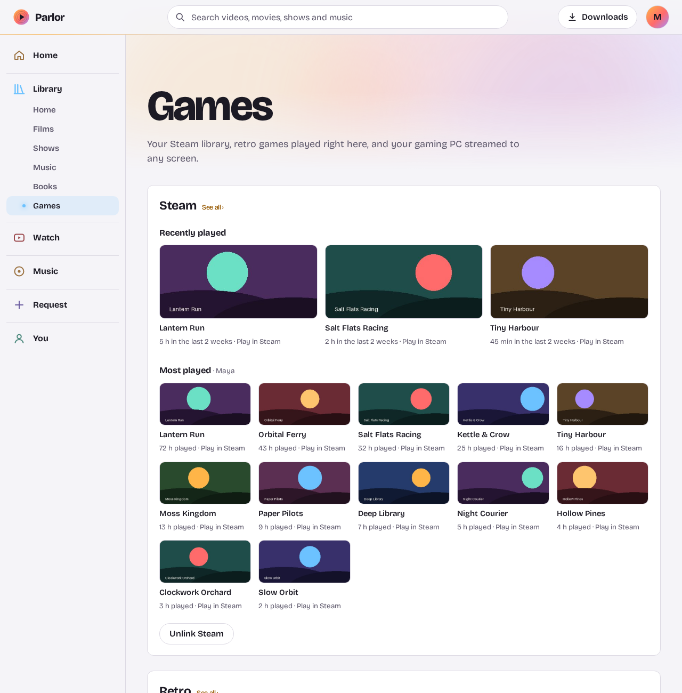
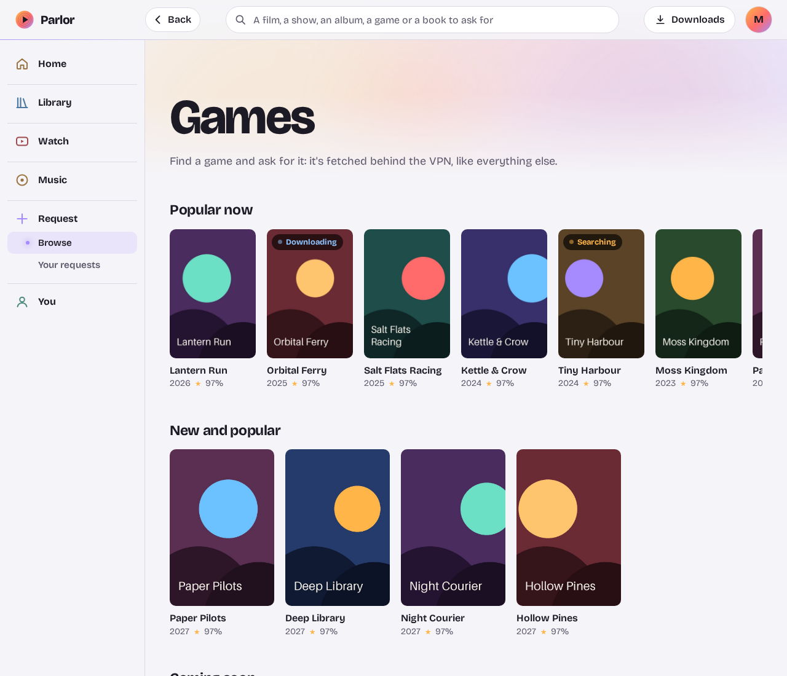

# Games

[← Parlor's README](../README.md)

<picture>
  <source media="(prefers-color-scheme: dark)" srcset="assets/screens/games-desktop-dark.png">
  
</picture>

**Games** (in the menu under **Library**) is one page with three parts: your Steam library, retro games played right in Parlor, and your gaming PC streamed to any screen. Each person sees their own. A fourth section covers asking for new games with Questarr.

## Steam

An admin adds a Steam Web API key once: on the Games page, open **Show the games you own on Steam here** (get a key at steamcommunity.com/dev/apikey). Until someone links Steam, that line sits under the retro games and the PC. It stays on the server: no browser ever sees it.

Each person then links their profile with any of these:

- its address (`steamcommunity.com/id/yourname` or `/profiles/7656…`);
- its custom name;
- its 17-digit id.

They see what they own, most played first, with what they played in the last two weeks above.

- **How often**: Steam is asked at most once an hour per person.
- **Pictures**: they come through Parlor and are kept.
- **Private profile**: it shows nothing; Games says which Steam privacy setting to change (Game details: Public).

## Retro games

Put games in `GAMES/roms/<system>/`, with a picture of the same name beside each if you like (`Game.png`). The systems are `nes`, `snes`, `n64`, `gb`, `gbc`, `gba`, `nds`, `vb`, `genesis`, `sms`, `gamegear`, `32x`, `segacd`, `psx`, `pce`, `atari2600`, `atari7800`, `lynx`, `ngp`, `ws`, `coleco`, `arcade`, `c64`, `dos` and `psp`.

**Play** opens the game on its own page with [EmulatorJS](https://emulatorjs.org) 4.2.3.

- **Emulator files**: Parlor fetches each emulator file from EmulatorJS's server the first time it's needed.
- **Checked**: it keeps a file only if it matches the sha256 pinned in `app/emulatorjs.json`, so after that it plays without the internet.
- **Saves**: the game's own save (its battery memory) goes to Parlor whenever it changes.
- **Save states**: they go to Parlor when you save one from the emulator's menu.
- **Private**: both are sealed like the rest of Parlor's data and each person's own; on another device they come back.
- **Where it reads**: Parlor only reads from inside `GAMES/roms` (links out of it are ignored).
- **Whose games**: bring your own games, and only ones you own.

## Streaming from your gaming PC

[Sunshine](https://app.lizardbyte.dev/Sunshine/) on your PC streams its screen; Parlor's bridge ([Moonlight Web](https://github.com/MrCreativ3001/moonlight-web-stream)) plays it in any browser, the TV's included. It's off until you turn it on in `.env`:

```sh
COMPOSE_PROFILES=games-stream
GAMES_STREAM=1
GAMES_STREAM_HOST=192.168.1.20   # this server's address on your network
```

Then run `docker compose up -d`.

- **The bridge's page**: it's only reachable through Parlor, at Library → Games → From your PC (an admin opens it once first).
- **No second login**: Parlor tells it who you are, and each person keeps their own PCs.
- **Add your PC**: add it by its address, and type the PIN it shows into Sunshine's page on the PC (Sunshine → PIN).
- **Picture and sound**: they go straight from the bridge to your browser over WebRTC on UDP ports 40000–40100, so those must reach the server.
- **From outside your home**: add a TURN server in `./moonlight-web/config/config.json` (`webrtc.ice_servers`).
- **Gamepads and keyboard capture**: they need Parlor on https.

## Games you ask for (Questarr)

[Questarr](https://github.com/Doezer/Questarr) is to games what Radarr is to films: you name a game, it searches the indexers and hands the download to qBittorrent, behind the VPN like everything else.

It runs at port 5000 (`http://your-server:5000`) and always asks for a login. Setup makes that login itself, with nothing typed by you: **Settings → Services → Questarr → show its login** shows an admin the name and password. Setup also:

- adds qBittorrent as its download client (category `games`, saved under `DOWNLOADS/games`);
- has it read Prowlarr's indexers, and again on any later setup run after you add or remove one in Prowlarr;
- points its library at your `GAMES` folder (`/data/games`), unless you chose another in Questarr.

### Ask for a game in Parlor

<picture>
  <source media="(prefers-color-scheme: dark)" srcset="assets/screens/game-requests-desktop-dark.png">
  
</picture>

You don't need Questarr's own page to ask for a game:

1. Open **Request** and press **See all** beside Games, or type a game's title in the search box. The rows (popular now, new, coming soon) and the search find games in Steam's store.
2. Open a game and press **Request**. An admin's request starts at once; a member's waits in **Request → Your requests** until an admin approves or declines it.
3. Parlor makes the request in Questarr, which searches your indexers for the game.
4. A release that passes every check is taken by itself. Otherwise the request reads **Pick a release** and an admin picks one from the list under it in **Your requests**.
5. The request reads **Downloading**, then **Downloaded** once Questarr has the files.

What to know:

- **The checks** for taking a release unseen: it is the whole game (not an update, an add-on or a crack alone), its title matches exactly, it comes from a scene group or a known repacker (or is listed on xREL), at least 5 people seed it, it was posted 3 or more days ago, and the game is out (a release of a game that isn't is never taken unseen). These read names and numbers the uploader chose, so they sort the likely from the unlikely; they can't prove a file is safe.
- **Switch it off**: an admin unticks **Take a release without asking** at the foot of **Request → Games**, and every request waits for a pick.
- **A game is a program.** Scan what you download before you run it, whoever picked it.
- **Nothing found** is tried again every 6 hours; **Search again** on the request looks now (a member can press it once every 5 minutes; each search asks every indexer). **Cancel** takes it out of Questarr too.
- **Where it lands**: in qBittorrent's `games` folder (`DOWNLOADS/games`). Questarr's moving of finished games into `GAMES` is off unless you turn it on in Questarr's Settings.
- **Who can ask**: anyone with the **Games** section (Settings → People → Access). The list of releases and the pick are the admins'. Other people see that a game is asked for and where it's at, not by whom.
- **“Questarr isn't set up yet”** on the page: run **Settings → Services → Set up again**. A Questarr set up by an older Parlor has a login Parlor doesn't know; requests need the one Parlor makes.

### It needs no keys from you

Questarr looks every game up at IGDB, which wants keys from a Twitch developer account. In this stack you register nothing: Parlor answers those lookups itself, from Steam's public store, so finding a game by its title works on a fresh install.

- What you get: titles, covers, screenshots, release dates, genres, Steam's review score, and the popular, new and upcoming lists.
- What you don't: games Steam doesn't sell (console exclusives, games only in another store) aren't found by title, though searching the indexers by hand in Questarr still works for them; and there are no editions or time-to-beat figures.
- Rather have IGDB's catalogue? Enter IGDB keys of your own in Questarr's Settings, then `docker compose restart questarr`: its lookups go to IGDB instead.

### How it's done

- Setup puts a small file and a random key into `./questarr/config`.
- The file is loaded into Questarr and sends its IGDB lookups to Parlor; the key goes with each one, and Parlor answers nobody without it.
- It is written against the Questarr version pinned in `docker-compose.yml`.
- When an update of Parlor changes the file, Questarr uses the new one from its next start (`docker compose restart questarr`).

### Login and network

- Questarr has one login: the name `parlor` with a long random password that Parlor made and keeps with its own data.
- A Questarr that an earlier Parlor set up keeps the login it got then (the name and password of the admin who ran setup).
- Like the other apps' pages, port 5000 is for your home network only.
- Until setup has run (it runs by itself when the stack starts), whoever reaches it first can make its login. Setup then waits for your password in case that login is yours, and says so if it isn't; so don't forward the port to the internet.

### Your own Questarr and the pinned image

- A Questarr of your own elsewhere is left alone (it keeps needing its own IGDB keys).
- The image is pinned to a version by its digest in `docker-compose.yml`, as the project is young: read its release notes before moving the pin.
- After moving it, run `python tests/live_stack.py --only questarr`, which searches a game by title for real.
