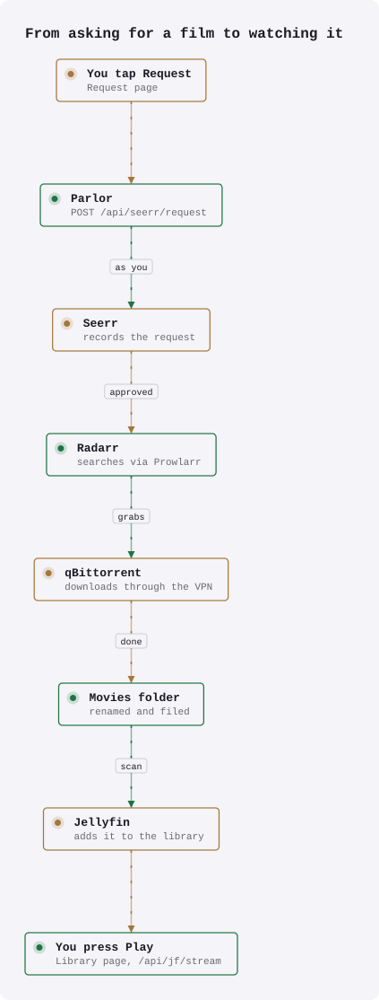

# How it works

[← Parlor's README](../README.md)

Parlor is the one app you open. It keeps the sign-in and the accounts, and talks to the other apps for you, so each does one job:

<picture>
  <source media="(prefers-color-scheme: dark)" srcset="assets/diagrams/architecture-dark.svg">
  
</picture>

Asking for a film shows the whole path. You never leave Parlor, and the film turns up in your Library when it has downloaded:

<picture>
  <source media="(prefers-color-scheme: dark)" srcset="assets/diagrams/request-dark.svg">
  
</picture>

What it costs to run, measured on one machine against the apps beside it:

<picture>
  <source media="(prefers-color-scheme: dark)" srcset="assets/charts/cost-dark.svg">
  
</picture>
