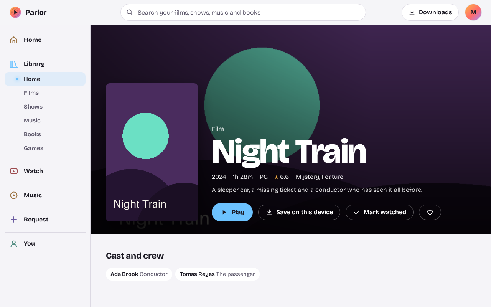

# The Library: playing Jellyfin in Parlor

[← Parlor's README](../README.md)

**Library**: play what's in Jellyfin right here: films and shows with resume, next up and watched marks kept in your Jellyfin account, music in a player that keeps going while you look around, audiobooks, and books in a reader.

<picture>
  <source media="(prefers-color-scheme: dark)" srcset="assets/screens/film-desktop-dark.png">
  
</picture>

Library plays what Jellyfin has, inside Parlor, with Parlor's login. Each person plays as their Jellyfin user (their Jellyfin sign-in, the user an admin linked, or the default in Settings), so resume points, watched marks, favourites and Next up are the same here as in Jellyfin's own apps.

## Films and shows

- **Browsing**: Continue watching, Next up and what's new in each library; every film, show, album and book; a show's seasons and episodes.
- **Sorting**: the **Sort** menu above a list: A–Z, recently added, year, rating, shuffle.
- **Filters**: the **Show** menu beside it: new to you, in progress, favourites.
- **Play**: **Play** resumes where you stopped; **From the start** doesn't.
- **Your place**: it's saved every few seconds and when you pause. Near the end it's marked watched and the next episode starts after a countdown.
- **Continue watching**: the **x** on a card takes that title out of the row. Its place goes back to the start and it isn't marked watched; it stays in the library.
- **Spoiler shield**: Settings → Playing videos → **Spoiler shield** hides the picture and summary of episodes you haven't watched in a show's episode list (the title stays). It's per device.
- **Rows from the last visit**: Library and Home draw their rows at once from what this device saw last time, then update them when the server answers; a server that's down leaves the last rows. Signing out forgets them.
- **Films & shows** (under Request) shows **Play** (or **Watch**, for a show) on a title Jellyfin has, straight into the Library.

## Playback

- **Direct play**: Jellyfin sends the file as it is when the browser can play it (H.264 or HEVC in MP4, VP9 or AV1 in WebM), and converts it otherwise.
- **Conversions end when you leave**: closing the player, opening another film or picking another quality tells Jellyfin to stop converting the last one, so a server with one graphics card isn't still busy with it when the next film starts.
- **Quality**: the quality menu asks for a lower bitrate when you're away from home.
- **Menus**: audio tracks, subtitles and chapters have menus.
- **Keys**: Space or K, J and L or ← and → for 10 s, F for full screen, M to mute, Shift+N for the next episode.
- **Skip intro**: on Jellyfin 10.10 or later, which finds intros and credits itself, a **Skip intro** or **Skip credits** button shows while one plays and jumps past it. An older Jellyfin, or a title it found none in, shows no button.
- **Double-tap**: on a touch screen, double-tap the left or right of the picture to go back or forward 10 s, and the middle for full screen. The bar at the bottom is the browser's own. With a mouse, double-click is full screen.

## Music and audiobooks

- **The bar**: they play in the bar along the bottom, which keeps playing as you move around Parlor and answers the lock screen's and keyboard's media keys.
- **Albums**: they play in order or shuffled.
- **Audiobooks**: an audiobook carries on from where you stopped, on any device.
- **Your own folder**: songs in your own music folder (Music → Your library → an album) play there too.

## Books

- **EPUB**: books open in a reader (pages, contents, text size; it remembers your page on that device).
- **PDF**: PDFs open in the browser's own viewer.
- **More books**: **Request → Books** finds a book and fetches it into this library: [Books](stack.md#books).
- **Needs**: reading needs your Jellyfin user to be allowed to download.

## A Jellyfin of your own

The Jellyfin that comes with Parlor needs nothing: setup makes its API key. To play from another Jellyfin, an admin fills three fields in **Settings → Jellyfin and signing in**:

1. **Jellyfin address**, as the server reaches it (`http://media.example.test:8096`).
2. **Jellyfin API key**: make one in Jellyfin under **Dashboard → API Keys**, and paste it. Parlor never shows it back; leave the field empty to keep the saved one.
3. **Jellyfin user to play as**: the Jellyfin user whose library people get when their account isn't linked to one of their own.

An account can play as a different Jellyfin user: type the name under that person in **Settings → People**, or empty the field to go back to the default. Setup links the first admin to the Jellyfin user of the same name, so with another Jellyfin, change or empty that one first.

## The Jellyfin key

- **The Jellyfin key stays on the server.** Streams, pictures and books go through Parlor, which adds the key itself and checks each one against what your Jellyfin user may see.
