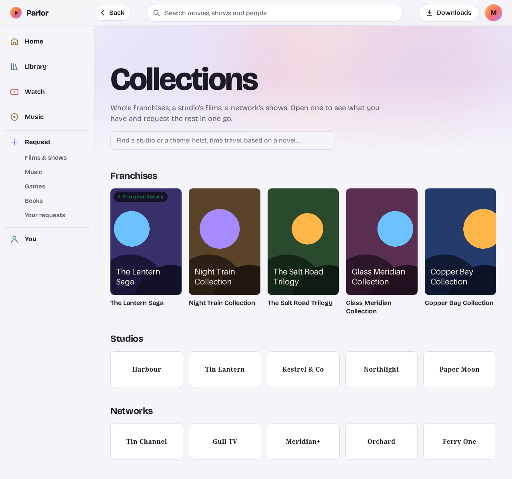
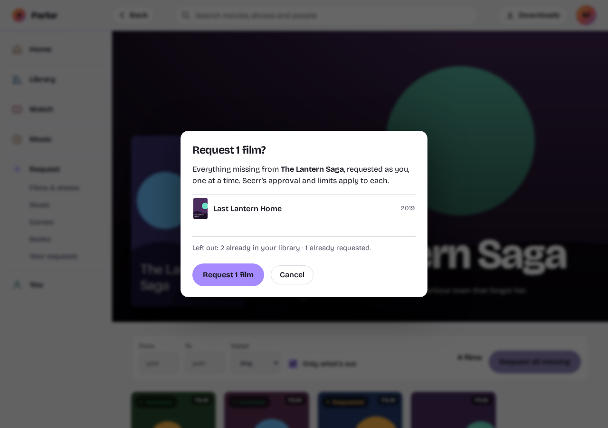

# Films & shows

[← Parlor's README](../README.md)

**Request → Films & shows**: discover, search and request films and shows through [Seerr](https://github.com/seerr-team/seerr). Each person requests as their own Seerr user. **Collections** opens a whole franchise, a studio's films, a network's shows or a theme, and requests everything you're missing in one go. Trailers play in the ad-free player.

## Your requests

**Request → Your requests** is one list of everything you asked for: films and shows from Seerr, albums and artists from Lidarr, games from Questarr, and the books Parlor fetches itself, each with where it's at.

- **One kind**: the row under the title narrows it to films and shows (with Seerr's filters: waiting, approved, available…) to music, to games, or to books.
- **Admins** see everyone's film and show requests there too, and approve or decline them.
- **Music**: how a music request is followed is in [The apps around Parlor](stack.md#request-music).
- **Games**: admins approve a member's request there and pick the release when Parlor isn't sure of one: [Games you ask for](games.md#ask-for-a-game-in-parlor).
- **Books**: nobody approves them; **Try another** swaps a wrong or stuck download for the next release: [Books](stack.md#books).

## Whole collections

Films & shows → **Collections** (the link under the page's title) starts from the franchises of the films you already have, then well-known franchises, studios and networks. Its search finds any other studio or theme (TMDB's keywords: heist, time travel, a shared universe).

- **Links**: a film's page links its collection ("Part of …"), studios and keywords, and a show's its networks.
- **A set's page**: it shows what you have and what's requested, and narrows by year, rating and whether it's out yet.

### Request all missing

- **Count first**: **Request all missing** lists exactly what would be requested and what's left out (already in the library, already requested, partly there). Nothing is sent until you confirm.
- **As you**: Parlor requests the titles one at a time as you, so Seerr's approvals and limits apply to each. It looks at each title again just before asking.
- **Limit**: one go is at most 250 titles; narrow a bigger set or come back for the rest.
- **Progress**: the job shows in the **Downloads** drawer and carries on with the tab closed and across a restart.
- **Stops**: it stops by itself when Seerr's request limit for you is reached, when Seerr stops answering, or when an admin closes Films & shows to you. **Carry on** picks up where it stopped.
- **Declined**: a title that was declined before is left for an admin.

<picture>
  <source media="(prefers-color-scheme: dark)" srcset="assets/screens/collections-desktop-dark.png">
  
</picture>

<picture>
  <source media="(prefers-color-scheme: dark)" srcset="assets/screens/request-all-desktop-dark.png">
  
</picture>
