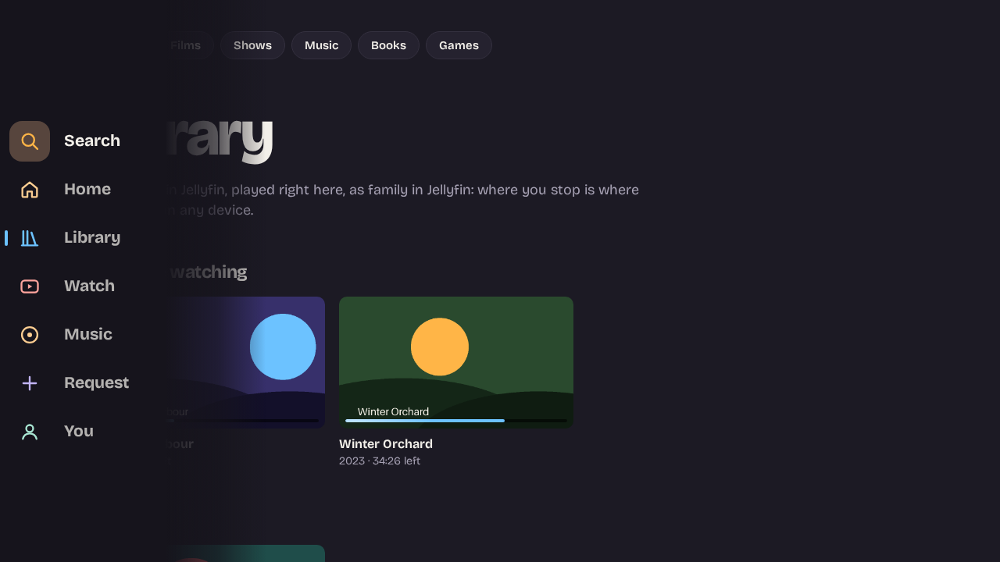
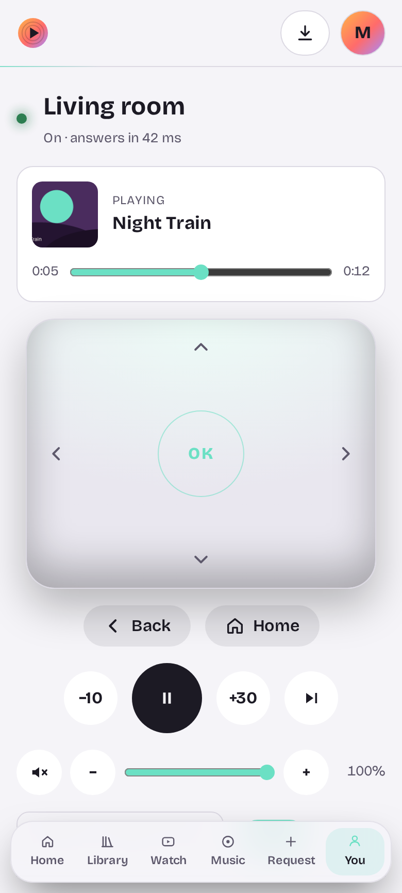

# On a TV

[← Parlor's README](../README.md)

<picture>
  <source media="(prefers-color-scheme: dark)" srcset="assets/screens/tv-screen-desktop-dark.png">
  
</picture>

<picture>
  <source media="(prefers-color-scheme: dark)" srcset="assets/screens/remote-phone-dark.png">
  
</picture>

Parlor on a TV is made for a remote, and your phone can be the remote. This page covers pairing a TV, the TV layout, the phone remote, and controlling the TV set itself.

## Pairing a TV

1. Open Parlor on the TV's browser at `http://your-server:8800/tv` (or install the Android app on an Android TV: it's in the TV's launcher and opens this way by itself; an LG added as a [TV set](#the-tv-set-itself-power-input-and-volume) opens it from **Open Parlor on it**). The TV shows an 8-character code.
2. On your phone open **You → TVs**, type the code and a name under **Add a TV**, then press **Pair**. Or point the phone's camera at the square under the code: it opens Parlor at **You → TVs** with the code filled in (sign in first if the phone isn't).
3. The TV signs itself in to your account.

No password is typed on the TV, and the code works once, for five minutes.

## The TV layout

Parlor on a TV is laid out for a couch and a remote: everything is bigger, there is no top bar, and nothing needs a mouse.

- **Home** is one screen that never scrolls. The title the focus is on fills the top: its artwork, its name, the year, how long is left, what it's about. Under it are rows of posters: Continue watching, Next up, My list (the films and shows you marked as favourites), what's new in each library, new from your subscriptions, Watch later, and the libraries.
- **Arrows on Home**: Left and Right walk a row, Up and Down change rows. Each row remembers where you were in it. The selected poster lifts and glows; the rows slide under it, so it is always in the same place.
- **OK and Back**: OK opens what's selected. Back returns to the very poster you opened it from; pressed again it goes to the first poster, then to the menu.
- **The menu** is a slim rail of icons on the left (Search, Home, Library, Watch, Music, Request, You). Left from the first poster reaches it, and its names show while the focus is in it. A section's pages are the row of links along the top of each of its pages.
- **Who's watching**: with two or more people in [the household](accounts.md#the-household-and-profiles-on-a-tv), the TV asks who is watching each time it starts, and a round picture at the foot of the menu opens the same screen later. Pick a person with the arrows and OK; one with a PIN gets a number pad (a remote's own number keys work too). The TV then starts again at Home as them.
- **Other pages**: the arrows move to the nearest thing in that direction, and what's selected has a bright outline. When a page opens, the focus is already in it.
- **A film or a video fills the screen.** A strip shows its name and where it is for a few seconds, and for 10 seconds when you pause it, then gets out of the way; a paused film left for 5 minutes shows your pictures like any idle screen.

  | Key | What it does while a film plays |
  |---|---|
  | OK | Pause, play |
  | Left, Right | Back or on 10 seconds |
  | Down | Sound, subtitles, quality and the rest. OK on a list steps to its next choice; Up or Back returns to the film |
  | Back | Leaves the film |

  When **Skip intro** or **Up next** shows, OK presses it.
- **A film that stutters**: the TV asks for a lighter stream by itself when it drops more than 15 in 100 frames for ten seconds, and says so. Quality in the options puts it back.
- **Search** has a keyboard on the screen: pick letters with the arrows and OK, and what's in the library shows beside it as you go. **Search YouTube and everything else** under the keyboard takes the same words to the full search. Text typed on a phone's remote lands here too.
- **Colour keys** on a remote that has them: red is Home, green is Search, yellow is the Library, blue is play or pause.
- **Left alone for 5 minutes** with nothing playing on the screen, the TV shows your own films' and shows' pictures one after another, dimmed and slowly moving, with the title, the time and the date (or the song, when music plays) small in a corner that changes with each picture, so nothing burns in. Before Home has loaded once on that TV there are no pictures yet, and it goes dark with a dim clock that moves each minute. Any key wakes it and does nothing else.
- **It looks after an OLED.** The clock, the rail and the other parts that never change drift a few pixels every 3 minutes, and a screen nobody has touched for 2 minutes dims; any key brightens it again. A film that is playing is never dimmed.

## Play on TV

A film's or episode's **On TV** button (on its page, and under the player while it plays, where it carries on from where you are), a YouTube video's (it carries on from where you are too), and **⋯ → Play on TV** on any album or song send it to the TV, which plays it with its own sign-in. With more than one TV on, you pick which.

## The remote

You find it in You → TVs → a TV. The app's shortcut **TV remote** (press and hold Parlor's icon on a phone) and the address `#/remote` open the remote of the TV that is on. From top to bottom:

- **What the TV shows.** While something plays: its picture, its title, and a line you drag to jump (it moves by itself in between). With nothing playing: where the TV is and what its focus is on, so you can steer without looking up.
- **The touchpad.** Swipe for an arrow. A short swipe is one step; a long one is a step for every 44 px, so one swipe walks along a row. Rest your thumb at the end of a swipe and it keeps going, quicker and quicker. Tap for OK. Tap an edge for one step that way, or hold the edge to keep going.
- **Back** and **Home**.
- **Play/pause**, back 10 s, forward 30 s, next song.
- **Volume**: mute, a slider, and − and + for one step.
- **A box** that searches the library from the phone: tap a film or an episode and it plays on the TV, tap a show and its page opens there. While the TV has a text box of its own open (its search, a sign-in), the box is that box's keyboard, letter by letter. **Send** types it on the TV and presses Enter.
- **More**: the film's own lists (sound, subtitles, quality), a sleep timer, in so many minutes or **When this ends** (the sound fades over the last half minute, what plays pauses with its place kept, the screen goes dark; at the end of an episode the next one doesn't start), **Continue on this phone** (the film opens here from where the TV was, and the TV pauses), **Stop**.

Every key acts the moment it is touched, not when the finger lifts, and dips so your thumb knows. A press that did not reach the TV shakes, and a notice says why once, not for every press of a run. The first line says which it is: this device is offline, Parlor can't be reached, or the TV is off.

With more than one TV, a list beside the name switches between them. With more than one person in the household, a round picture beside the name says who the TV is acting as; press it to change (see [accounts](accounts.md)).

While a TV plays, Parlor's other pages show a small **On TV** bar: what plays, a button to pause it, and a press on it opens the remote.

- **Two phones** can drive the same TV; both see what it does.
- **A computer's** arrow keys, Enter and Space work it too.
- **Volume**: the remote's volume is Parlor's on the TV. The TV set's own power, input and volume are under it, once an admin has added the set (below).
- **Connection**: the remote talks over server-sent events, so it works through the Android app and any reverse proxy. A proxy must not hold `/api/tv/events` back or compress it: Parlor sends `X-Accel-Buffering: no` (nginx honours it) and `Cache-Control: no-transform`. The stream stays open for as long as the TV or the remote is: Parlor closes a connection only when nothing is being sent on it, so a TV is never deaf for a few seconds after its page loads.

### How fast it is

The remote's status line says how fast the TV answers: `On · answers in 12 ms`.

- Each press gets a number. The TV answers it after the frame that shows it, and Parlor times the way there and back.
- A press takes about 10 ms from the phone's request to the TV acting on it (measured on a living-room TV through a home reverse proxy: median 8 to 11 ms, worst 15 ms, 22 presses).
- A held arrow waits for the last press to be sent before it sends the next, so presses never pile up on a slow link.
- If the line says `slow to answer`, look at the TV: its page is slow to draw (its graphics chip, or a film it is decoding without help), or its link to Parlor is.

What the TV page costs to draw, at 3840×2160 on a software graphics chip with the page's thread slowed four times (`tests/perf_tv.py`):

| | Median frame | A press to its frame |
|---|---|---|
| Before: three animated blurs behind the page, a blurred bar on top | 100 ms (10 frames a second, with nothing pressed) | 152 to 171 ms |
| Now: TV mode draws no live blur, and Home holds still until you press | 16.7 ms (60 frames a second) | 13 to 20 ms |
| Home as a hero over rows of posters | 16.7 ms with nothing pressed; 17 to 33 ms while the focus moves | 30 ms along a row; 90 to 190 ms from one row to the next |

A change of row moves every row at once, so it costs the most; the frame times stayed under 34 ms in every run (five runs, on a machine doing other work). A TV that can't keep up with the picture behind the page fading (fewer than 24 frames a second, twice in a row) stops fading it: the picture changes at once from then on.

### Sound

A browser won't start sound that nobody pressed a key for, and a phone's press doesn't count as one on the TV.

- Start a kiosk's Chromium with `--autoplay-policy=no-user-gesture-required`.
- Without it, the TV shows **Press OK to play** and the remote says the TV is holding the sound back.
- A muted TV page says so on the remote too; turning the volume up takes the mute off.

### Updates

A TV left on reloads itself when Parlor was updated, as soon as nothing is playing. While Parlor restarts the remote says **Off**; the TV asks again every 5 seconds until Parlor answers, also when a proxy in front of Parlor answered in its place with an error page.

The Android app on a TV signed in with a password (its own sign-in screen) counts as a TV too: it is your account's TV, your phones list it under **You → TVs**, and like every TV it is never signed in as an admin.

## Adding someone's phone as a remote

Anyone with an account in Parlor can work a TV that shows Parlor already, from their own phone, and be one of its people in **Who's watching**:

1. On the TV open **You → Add a remote**, or **Add someone** in Who's watching. The TV shows a code and a square.
2. On the phone point the camera at the square (it opens Parlor and asks to sign in if it isn't), or open **You → TVs** and enter the code under **Add a TV**.
3. The phone asks **Add this account to *owner*'s TV "*name*"?** Say yes only to a TV in front of you. It then lands on that TV's remote.
4. The TV shows the new person at once, with a fresh code for the next one.

The code works once, for five minutes, and a new one shows up by itself. That account gets this TV only:

- Not the owner's other TVs, and never as an admin.
- The TV acts as them only when they pick themselves on their own phone's remote. Picking them on the TV's screen asks for their PIN, so without a PIN it can't be done there.
- Their remote lists only them and the TV's owner, not the rest of the household.

They take themselves off with **Remove** under **You → TVs**. The TV's owner sees them under that TV there, as **Also works it**, and takes anyone off with the **×** by their name. Unpairing the TV takes everyone off.

**Without the code, when the owner is an admin.** A TV paired with an admin's account can be given to anyone from the admin's phone or computer: **You → TVs**, under that TV, **Add a person**, pick the account, **Add**. They get the TV just as if they had scanned its square, and can pick themselves on it from their phone, so the TV acts as them and not as the admin. This is the way when the admin account isn't [in the household](accounts.md#the-household-and-profiles-on-a-tv): a TV paired by an account outside the household isn't shared with the household by itself. An owner who isn't an admin doesn't see the list of accounts and uses the code.

A TV page opened before 21 November 2026 doesn't do that last part: after an update it can stay **Off** on the remote while its screen looks fine. Reload it once (restart the TV's browser).

## Unpairing and safety

- A TV that's off or not showing Parlor shows as off; it comes back by itself.
- **Unpair** signs it out. Signing out everywhere unpairs every TV.
- A TV is never signed in as an admin, even an admin's, so only enter a code you see on a TV in front of you.
- A TV can act as another person in the household instead of its owner, after their PIN if they set one; see [the household and profiles on a TV](accounts.md#the-household-and-profiles-on-a-tv).
- Admins see every account's TVs, and a remote for each, in **Settings → TVs**.

## The TV set itself: power, input and volume

An admin adds the set in **Settings → TVs → TV sets**:

1. Choose its type.
2. Type a name and its address on your network (`192.168.1.40`, or a name your router gives it).
3. Press **Pair** or **Test**.
4. The admin ticks which accounts may use it (admins always can).

**You → TVs** and the remote then have a row with the set's own **Power**, **Input**, **Vol −**, **Mute**, **Vol +** and **HDMI 1–4**, whichever that type has. The row is there with no TV paired yet.

An LG also has **Open Parlor on it**: the TV opens its own browser at this Parlor's TV screen, so nobody types an address with the TV's remote. It shows the pairing code the first time; pair it as above and the TV stays signed in. Four things to know:

- The TV opens the address you are using Parlor by, so use the server's address on your network (`http://192.168.1.20:8800`), not `localhost` and not a public name: Parlor only sends a TV to an address on your home network.
- An LG paired before this button existed has no leave to open anything: remove it in **Settings → TVs** and add it again.
- An LG always starts in webOS. Parlor can't replace that; after switching on, press **Open Parlor on it**.
- **LG's browser needs the internet to start.** On a real LG (an OLED C6) with its internet blocked, the browser showed a spinner, then "Check network connection" (error -7), and never asked Parlor for the page. It opened Parlor only when the browser was already open. On a TV kept off the internet, play films with **On TV → (its own player)** below, which needs no browser. Parlor's page itself loads only from Parlor, its font included, so a browser that does start shows it at once.

### A film in the TV's own player

An LG can also play a film or an episode from your library, or a video from **Watch**, with no browser and no Parlor screen on the TV: the TV's built-in network player fetches the file from Parlor, and your phone is the remote.

1. Open a film or an episode in the **Library**, or a video in **Watch**, and press **On TV**: on its page, or under the player while it plays here, which pauses and hands the TV the spot it got to. Sets that can play are listed as "(its own player)".
2. Pick the set. The TV starts the film from where you left off, and the phone goes to **You → TVs**.
3. Under **The TV set** you see what is playing, with **−10**, **Pause**, **+30**, **Stop** and a line to press along. Where it got to is saved to your library as it plays.

What it needs:

- **An address the TV can use.** The TV fetches the film over plain `http` from an address on your home network. If you open Parlor by a name or over https, an admin types the plain one in **Settings → TVs → The address TVs reach Parlor at**, like `http://192.168.1.20:8800`. Empty means the address you are using.
- **A way through, if a firewall sits between them.** Parlor's server asks the TV on UDP port 1900, then talks to the TCP port the TV answers with (it differs by model, and an LG changes it). An LG on another network segment than the server doesn't answer that question, so Parlor then looks through the TV's TCP ports 1024–9999 for its player: allow the server those. The TV fetches the film from Parlor's port (8800): if it can't, Parlor says the TV couldn't fetch it. The TV needs no internet.
- **The TV on.** A TV in standby doesn't answer.

A **Watch** video plays one of two ways:

- **Downloaded**: the TV gets the file, at the quality you downloaded.
- **Not downloaded**: the TV gets YouTube's one stream that has picture and sound together, fetched through Parlor. It is small, usually 360p, and Parlor says so when it starts. For the full picture, download the video first, then press **On TV**. A video with no such stream plays only once downloaded; a live stream doesn't play on a set.

Where a Watch video got to is saved to your Watch history.

Limits, on purpose for now:

- A film that is playing keeps its link through a restart or an update of Parlor, so the TV can fetch the rest when Parlor is back, and the remote still shows it. If the TV froze while Parlor was away (it says playing but its time has stopped), the remote sends the film back to it from that spot by itself within a few seconds; if it doesn't catch, press **On TV** again.
- The TV gets the file as it is, but for its list of tracks (below). Parlor doesn't convert it, so a file the TV can't play is refused by the TV, and a sound format it lacks plays silent. Most MP4 and MKV films with H.264 or HEVC video play.
- No choice of subtitles or sound track from the phone: the TV's own remote picks from what is in the file.
- A TV's own player is pickier than a browser, and starts the sound and subtitle tracks a file marks as default. So Parlor rewrites an MKV film's list of tracks as it sends it (the film on disk and its pictures and sound stay as they are):
  - a sound track TVs play (AC3, E-AC3, AAC) in the same language, not a commentary, goes ahead of a Dolby TrueHD or DTS one and is the default;
  - subtitles are off, unless the file marks them forced (the ones for foreign lines);
  - the TV's remote still lists every track.

  If a film still plays silent, choose its other sound track with the TV's remote. When it has none, or its picture is one many TVs can't show (AV1, or Dolby Vision with no plain picture under it), Parlor says so when it sends the film. On a real LG (an OLED C6), a film whose first sound track is Dolby TrueHD played with sound from its AC-3 track, with subtitles off. Converting a film on the way was tried on a real LG and the TV wouldn't start the stream reliably, so that isn't in.
- The link the TV fetches by needs no sign-in, since a TV can't sign in. It is a long random name, made for one film, never shown in a page or a log, and gone when you press **Stop**, when the remote sees the film end, or after 12 hours at most. It is kept in Parlor's database, so it outlives a restart (above).
- Only an LG is listed. It has played a film on a real LG (an OLED C6), with pause, skip and resume from the phone; other models are untested. If yours refuses, the message says what the TV answered.

With more than one set you pick which goes with the TV, and the phone remembers.

| Type | On the TV, once | Good to know |
|---|---|---|
| **Roku** | Settings → System → Advanced system settings → **Control by mobile apps** → Enabled (or Permissive) | No pairing. Power needs a Roku TV; a Roku stick has no power button to press. |
| **LG (webOS)** | Press **Pair** in Parlor, then **Accept** on the TV's prompt within 30 seconds | Parlor keeps the key the TV gives it. To switch the TV on, type its MAC when adding it and turn on the TV's **Mobile TV On** / **Turn on via Wi-Fi** (wired is more reliable). |
| **Samsung (Tizen)** | Press **Pair** in Parlor, then **Allow** on the TV's prompt | Parlor keeps the token. If the TV said no once: Settings → General → External Device Manager → Device Connection Manager → Device List. Switching on needs the MAC too. |
| **Android TV / Google TV** | Developer options (press **Build** seven times in About) → **USB debugging** and **Network debugging** on; press **Test** in Parlor, then tick **Always allow from this computer** and **Allow** on the TV | Anyone on the network can ask an Android TV for a debugging connection: allow only Parlor's server, and never open port 5555 to the internet. Parlor keeps its adb key in its database, so a rebuilt container isn't asked about again. |
| **HDMI-CEC adapter** | Nothing: it controls whatever is on the HDMI cable | The adapter is plugged into the server and passed into Parlor's container, e.g. `devices: ["/dev/ttyACM0:/dev/ttyACM0"]` for a USB adapter (`/dev/cec0` on a Raspberry Pi's own HDMI port). It has no address. **HDMI 1–4** tell the TV which of its ports to show. |

### Only your home network

- A set's address must be in 10.x, 172.16–31.x, 192.168.x or fc00::/7.
- It must not be on Docker's own network where Parlor's other containers are (unless `LAN_SUBNET` says that is your home network).
- Loopback, link-local (169.254.x and cloud metadata addresses) and anything on the internet are refused.
- A name is looked up again and checked before every connection, and Parlor connects to the address it checked.
- Redirects are not followed.

### Keys stay in

- Pairing keys, tokens and the adb key are in Parlor's encrypted database.
- While Parlor runs, adb reads its key from a copy in a temporary folder inside the container that only Parlor can read.
- Pairing keys, tokens and the adb key are never sent to a browser or written to the log.
- **Remove** forgets a set's key or token.

### Who can press what

- A member only sees and presses the sets an admin ticked for their account.
- Buttons are rate-limited, and a TV that doesn't answer within a few seconds says so on the remote.

### Tested against stand-ins

These were built against each maker's published protocol and tested against stand-ins of each, not against every model: if yours behaves differently, **Test** says what the TV answered.
