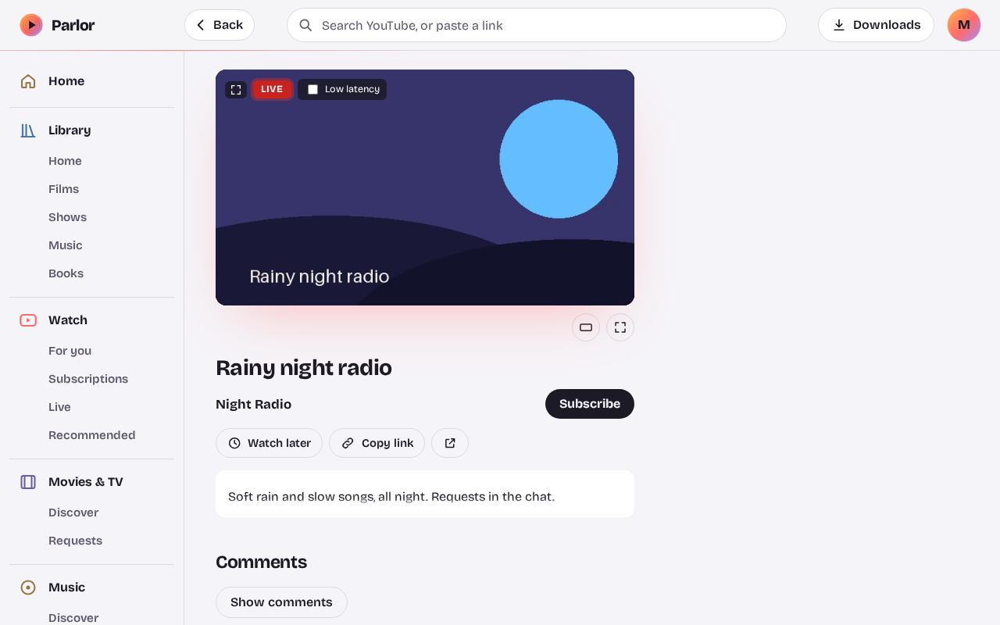
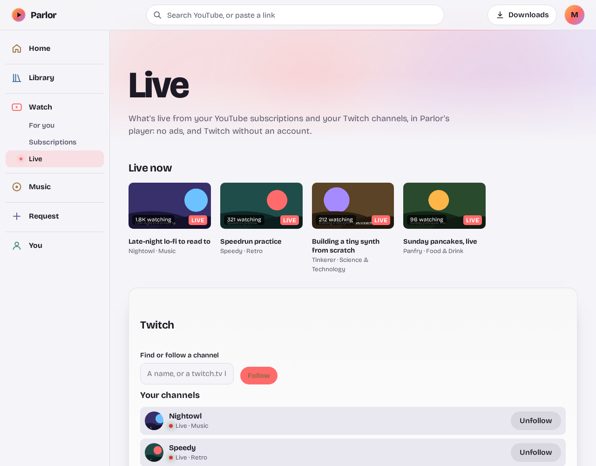
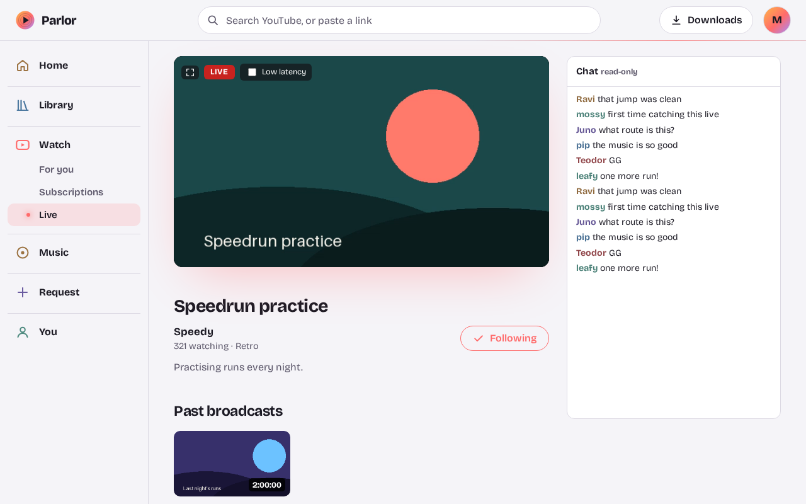

# Watching YouTube

[← Parlor's README](../README.md)

**Watch**: YouTube without ads, in up to 4K. Search, channels, playlists, your subscriptions feed, recommendations, continue watching, watch later and history. Fast downloads with chapters, subtitles and the thumbnail built in, or just the audio, straight into your music library.

<picture>
  <source media="(prefers-color-scheme: dark)" srcset="assets/screens/watch-live-desktop-dark.png">
  
</picture>

This page covers watching, subscribing, live streams, downloads and how Parlor keeps up with YouTube's changes.

## The player

The player streams through your server:

- **Separate streams**: YouTube serves HD video and audio separately, and its stream links only work from the address that asked for them. Parlor fetches both, in byte ranges, and the player keeps them in step.
- **What works**: seeking, quality changes (144p to 4K, HDR when your browser can show it), captions, playback speed, picture-in-picture and your system's media keys.

- **SponsorBlock**: sponsors, self-promotion and "like and subscribe" segments are skipped (with Undo), and the seek bar shows every marked segment, the chapters and YouTube's "most replayed" curve. Choose categories in Settings. Lookups use a hash prefix, so SponsorBlock never learns which video you're watching.
- **Resume**: videos pick up where you left off, on any device.
- **Keys**: Space or K to play and pause, J and L to skip 10 s, ← and → for 5 s, ↑ and ↓ for volume, M to mute, F for full screen, T for theater mode, C for captions, < and > for speed, 0–9 to jump, Shift+N for the next video, / to search.
- **Live streams** play here too, with going back and Go live: see [Live](#live).

## Browsing

You don't need links or an account to find something to watch. **Watch → For you** has:

- **Continue watching**, and **Because you watched …**: the videos YouTube suggests beside the ones you watched last. The **x** on a continue-watching video takes it out of the row (and out of History).
- **New from your subscriptions**, and a row of **Recommended** (**See all** opens the whole page).
- **Topics**: a shelf of this week's most-watched videos for each topic you pick (Music, Gaming, Science… to start; **Edit topics** to change them). YouTube retired its Trending page, so this stands in for it. Each account has its own topics.

The player's **Up next** list is YouTube's own suggestions for that video, and autoplay follows it. Channels in search results have a Subscribe button.

## Subscriptions

Subscribe on any channel or video page, or import them in You → Channels from:

- Google Takeout (`subscriptions.csv`, under YouTube and YouTube Music)
- NewPipe or FreeTube (`.json`)
- Invidious or FreeTube (`.opml`)
- a list of channel links or `@handles`

The feed reads each channel's public RSS feed (no Google account involved) and falls back to yt-dlp when a feed is down. **Hide Shorts in feeds** in Settings filters them out. Export your list as OPML any time.

## Recommended

Without a YouTube account, Recommended mixes two kinds of video, so no single video or channel takes over:

- videos like the ones you watched last
- new videos from the channels you watch most but don't follow

For YouTube's own recommendations, add your YouTube cookies in Settings:

- **Export**: use a "cookies.txt" browser extension while signed in to youtube.com.
- **What it adds**: your YouTube feed and YouTube watch later. It also plays videos that need a sign-in (age-restricted ones).
- **Storage**: the cookies are stored with owner-only permissions and used only for those requests.
- **Risk**: YouTube can flag accounts used this way, so a spare account is safer.

## Live

Watch → **Live** shows who's live now: YouTube lives from your subscriptions (with what's starting soon) and the Twitch channels you follow.

<picture>
  <source media="(prefers-color-scheme: dark)" srcset="assets/screens/live-desktop-dark.png">
  
</picture>

- **YouTube lives** play in Parlor's player like any video, without ads. Go back over the last hour or so; the **LIVE** badge turns into **Go live** when you're behind, and takes you back. **Low latency** brings you closer to live, at the price of more pauses on a weak connection.
- **Twitch** needs no account.
  - **Following**: follow channels by name or link, search for them, or paste many at once (Twitch's own export works).
  - **A channel's page**: it plays the stream live with its chat beside it (read-only), and lists its past broadcasts and clips.
  - **Ads**: Twitch's ads are taken out on the way. While one runs, the picture holds with a note, and the stream is back when it ends; the ad itself is never fetched.
- Everything goes through Parlor, so your browser never talks to YouTube or Twitch, and Parlor hands out only addresses it has signed, so it can't be used to fetch anything else.

<picture>
  <source media="(prefers-color-scheme: dark)" srcset="assets/screens/twitch-desktop-dark.png">
  
</picture>

## Downloads

Use the download button on any video (choose Best up to 4K, 1080p, 720p or 480p), or **Download all** on a playlist.

- **Videos** go to `VIDEO_DIR/<channel>/<title> [<id>].mp4`, with chapters, English subtitles, the thumbnail and the description embedded. Jellyfin and Plex read them, and they play in Parlor from You → Downloaded. Up to 1080p Parlor prefers H.264 + AAC, which plays everywhere; higher qualities only exist as VP9 or AV1.
- **Cut sponsors out of downloaded videos** (Settings) removes SponsorBlock's sponsor segments from the file.
- **Save audio to music** puts a tagged audio file (artist, album, square cover art) in your music library, in music-fndr's format and bitrate. Non-music parts of music videos are cut out.
- Downloads resume after a restart. If YouTube rate-limits the server, they wait 15 minutes and try again instead of failing.
- **Clearing out old downloads** (Settings → Downloaded videos, off by default): delete each video a week, 30 days, 90 days… after it was downloaded, or only once someone has watched it to the end, counting from then. Press **Keep** on a video in You → Downloaded and it's never deleted automatically. Each video there says when it goes.

## Keeping up with YouTube

YouTube changes often, and a yt-dlp a few weeks old starts failing. Parlor keeps it current:

- Parlor updates yt-dlp every time it starts.
- It checks again every `UPDATE_HOURS`.
- When there's a new one it restarts between downloads to load it. Docker brings it back and the queues carry on.

### When YouTube changes something before then

There's nothing to do either:

- **Trigger**: a download, video or search fails because of the change (not a rate limit, not a removed or private video). Parlor then updates yt-dlp straight away, at most once an hour.
- **Nightly build**: it uses yt-dlp's nightly build when the regular release has no fix yet, and moves back to the regular release once a newer one is out.
- **What you see**: those downloads, videos and songs alike show "YouTube changed something; waiting for a yt-dlp update" and wait instead of failing.
- **Replacing yt-dlp**: it is replaced only once the running downloads have finished. New ones hold until Parlor restarts to load it, then they all carry on (each waits at most three times before it's marked failed).
- **Off switch**: `HEAL=0` turns this off.
- **If it can't install**: if yt-dlp can't be installed there (a read-only image), Parlor says so once in its log and stops trying until it restarts.
- **No internet**: without internet for a while, it simply tries again on the next failure an hour later.
